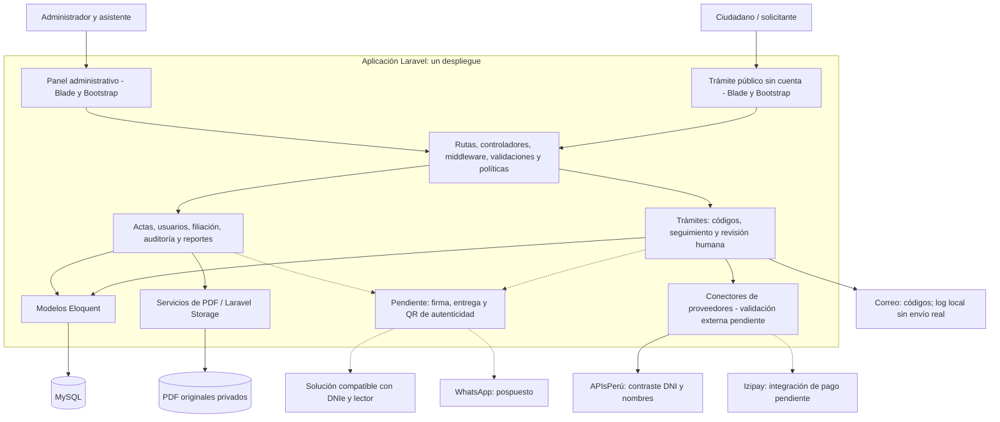

# Arquitectura inicial del sistema

## Alcance de la vista

Vista general actualizada del proyecto Registro Civil en desarrollo al 15 de octubre de 2026. La aplicación es un monolito Laravel con MVC y servicios, interfaz Blade y Bootstrap, MySQL y archivos privados. El panel y el trámite público forman parte del mismo despliegue local.

Las líneas continuas muestran relaciones actuales; las discontinuas indican funciones futuras. El conector de APIsPerú existe, pendiente de validación externa. Izipay es el proveedor de pagos seleccionado y su integración está pendiente.

## Diagrama de arquitectura

## Responsabilidades

- **Presentación:** vistas Blade con Bootstrap para el personal y el trámite público. El flujo actual de `/tramite` no crea usuarios; el flujo anterior con cuentas se conserva por compatibilidad histórica.
- **Control y negocio:** rutas y controladores reciben peticiones; middleware, Form Requests y políticas aplican controles. Los servicios coordinan operaciones como registro, validación de PDF, búsqueda pública, códigos, auditoría y conectores. Algunas consultas y decisiones permanecen en controladores y modelos: la vista expresa responsabilidades, no una separación rígida de todas las clases.
- **Persistencia:** Eloquent accede a MySQL. Los servicios de archivos usan Laravel Storage para PDF privados. La base conserva metadatos y hashes, no el binario de las actas.
- **Integraciones:** parten de los componentes responsables de la aplicación. APIsPerú no se presenta como API directa de RENIEC. Izipay requiere integración y validación; el navegador no debe confirmar pagos por sí solo.

## Límites actuales

La aprobación administrativa deja el trámite pendiente de firma. No existe entrega ciudadana, firma DNIe ni QR de autenticidad operativo. Un eventual QR de pago no valida un acta; no se presupone que la modalidad de Izipay elegida utilice QR. WhatsApp está pospuesto; colas y reintentos, respaldo operativo, publicación y sincronización nube/municipalidad siguen pendientes.

La revisión de filiación conserva el acta central, su numeración y PDF; registra cambios únicamente en campos de padres con historial y control de versión. No constituye una rectificación oficial ni acredita automáticamente parentesco.
