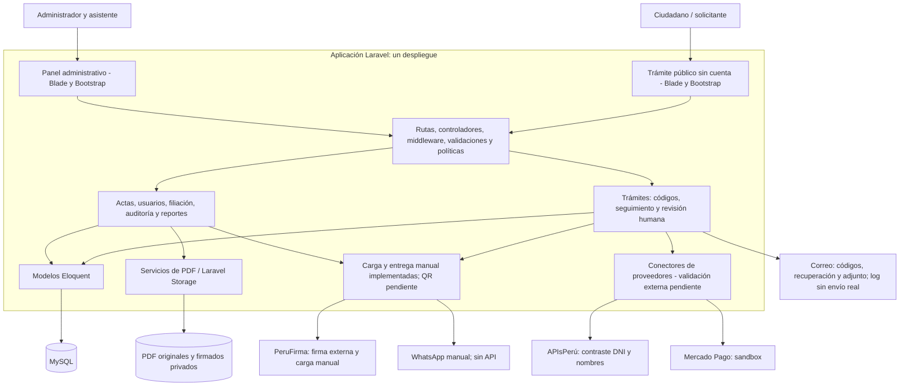

# Arquitectura inicial del sistema

## Alcance de la vista

Vista general actualizada del proyecto Registro Civil en desarrollo al 22 de octubre de 2026. La aplicación es un monolito Laravel con MVC y servicios, interfaz Blade y Bootstrap, MySQL y archivos privados. El panel y el trámite público forman parte del mismo despliegue local.

Las conexiones muestran responsabilidades locales implementadas; la verificación pública por QR sigue pendiente. Los pagos usan Mercado Pago en sandbox, no para cobros reales de producción. La firma se realiza externamente con PeruFirma y luego se carga el PDF firmado.

## Diagrama de arquitectura

## Responsabilidades

- **Presentación:** vistas Blade con Bootstrap para el personal y el trámite público. El flujo actual de `/tramite` no crea usuarios; el flujo anterior con cuentas se conserva por compatibilidad histórica.
- **Control y negocio:** rutas y controladores reciben peticiones; middleware, Form Requests y políticas aplican controles. Los servicios coordinan operaciones como registro, validación de PDF, búsqueda pública, códigos, auditoría y conectores. Algunas consultas y decisiones permanecen en controladores y modelos: la vista expresa responsabilidades, no una separación rígida de todas las clases.
- **Persistencia:** Eloquent accede a MySQL. Los servicios de archivos usan Laravel Storage para PDF privados. La base conserva metadatos y hashes, no el binario de las actas.
- **Integraciones:** parten de los componentes responsables de la aplicación. APIsPerú no se presenta como API directa de RENIEC. Mercado Pago se usa en sandbox para pruebas; la firma se realiza externamente con PeruFirma.

## Límites actuales

La aprobación administrativa no firma ni entrega por sí sola. Ya existen carga de PDF firmado externamente, verificación CMS, revisión institucional, publicación como LISTA y descarga privada con hash y auditoría; correo adjunto y WhatsApp manual dependen de preferencias. La confianza del certificado y facultades requieren revisión humana. La firma web automática no forma parte del flujo: se firma con PeruFirma fuera del sistema y luego se carga el archivo. QR de autenticidad, API WhatsApp, colas/reintentos, respaldo operativo, despliegue y sincronización siguen pendientes. Mercado Pago en sandbox no acredita cobros reales de producción.

La revisión de filiación conserva el acta central, su numeración y PDF; registra cambios únicamente en campos de padres con historial y control de versión. No constituye una rectificación oficial ni acredita automáticamente parentesco.
