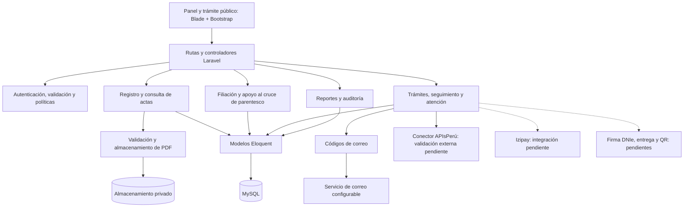

# Componentes arquitectónicos

Vista de responsabilidades de Registro Civil dentro de una aplicación Laravel MVC con servicios. Los componentes agrupan clases existentes; no representan servicios desplegados por separado.

Las líneas discontinuas indican componentes pendientes. Con correo `log` no se envían mensajes. La integración anterior de pagos queda descartada: no se representa como implementación de Izipay. La aprobación actual no firma ni entrega documentos. WhatsApp está pospuesto.

El detalle de responsabilidades, carpetas y relaciones se encuentra en el [nivel 3 de C4](../modelo-c4/Nivel3-Diagrama-de-Componentes.md). Las decisiones se mantienen en el [registro ADR](../analisis-de-sistema/07-decisiones-arquitectonicas.md).
