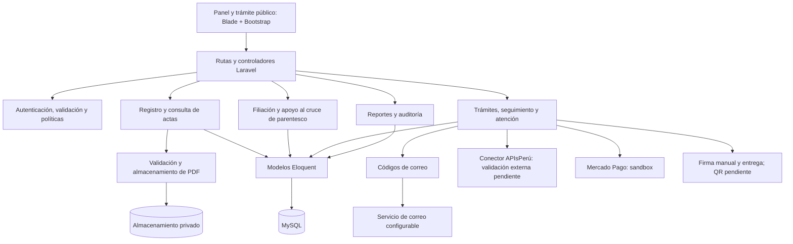

# Componentes arquitectónicos

Vista de responsabilidades de Registro Civil dentro de una aplicación Laravel MVC con servicios. Los componentes agrupan clases existentes; no representan servicios desplegados por separado.

El componente de entrega incluye carga y verificación CMS del PDF firmado externamente con PeruFirma, revisión y publicación como LISTA, descarga protegida y correo adjunto según preferencia. WhatsApp usa enlaces manuales, sin API. QR de autenticidad sigue pendiente; con correo log no hay envío real. Los pagos se realizan con Mercado Pago en sandbox, no en producción. Perfil/foto e incidencias se atienden desde los controladores internos existentes; ambos roles internos pueden acceder a las rutas de carga y publicación.

El detalle de responsabilidades, carpetas y relaciones se encuentra en el [nivel 3 de C4](../modelo-c4/Nivel3-Diagrama-de-Componentes.md). Las decisiones se mantienen en el [registro ADR](../analisis-de-sistema/07-decisiones-arquitectonicas.md).
