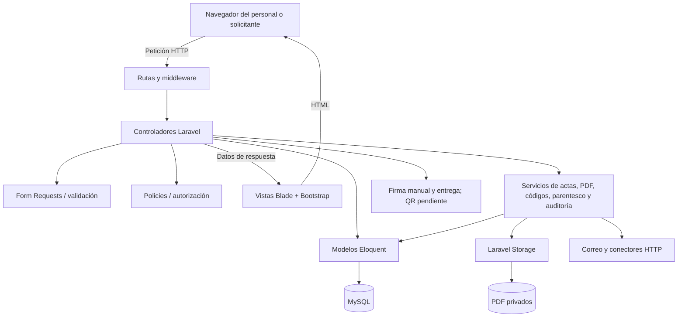

# Enfoque arquitectónico: MVC con servicios

## Objetivo y aplicación

Registro Civil usa MVC de Laravel con servicios de apoyo para organizar presentación, control, reglas y persistencia. Blade y Bootstrap generan la interfaz desde la misma aplicación. Los servicios colaboran con Eloquent, Laravel Storage, correo y clientes HTTP; no se presupone un dominio independiente del framework.

| Elemento | Responsabilidad | Ejemplos del desarrollo |
|---|---|---|
| Vista | Mostrar datos y formularios y presentar respuestas sin exponer el archivo al público. | `resources/views/actas`, `portal`, `reportes`, `auth`. |
| Controlador | Recibir peticiones, coordinar validación y autorización y devolver vistas o archivos. | `ActaController`, `PortalPublicoController`, `AtencionPublicaController`, `FiliacionController`, `ReporteController`, `EntregaDocumentoController`, `CanalEntregaController`, `PerfilController`, `IncidenciaController`. |
| Servicio | Reunir operaciones reutilizables y coordinar tareas del negocio o integraciones. | `ActaService`, `PdfValidationService`, `PdfStorageService`, `AuditoriaService`, `CodigoTramiteService`, `CruceParentescoService`, `FirmaDocumentoService`, `FirmaPeruService`, `IzipayService`, `IncidenciaService`, `WhatsAppConsulta`. |
| Modelo | Representar datos, relaciones y reglas asociadas al registro persistido. | `Acta`, `ActaNacimiento`, `ActaMatrimonio`, `ActaDefuncion`, `TramitePublico`, `PagoTramite`, `TramiteEvento`, `User`. |
| Controles transversales | Autenticar, validar entrada, limitar intentos, autorizar y registrar acciones. | Middleware, Form Requests, políticas y auditoría. |
| Persistencia e integración | Guardar datos y documentos y comunicarse con proveedores desde el servidor. | Eloquent/MySQL, Laravel Storage, correo, `ApisPeruService`, `PortalHttpOptions`; `IzipayService` y controladores de pago y entrega existentes; adaptador web Firma Perú sin activación institucional. |

`Solicitud` y `SolicitudEvento` conservan el flujo anterior con cuentas; el trámite público actual se representa mediante `TramitePublico`. No son nombres intercambiables para el mismo proceso.

## Diagrama de colaboración

Las conexiones representan colaboraciones y acceso a datos; no afirman que toda consulta pasa por un servicio. La auditoría se invoca desde los responsables de cada operación, no desde la interfaz pública.

## Flujos representativos

1. **Registro de acta:** el controlador autoriza y valida la entrada; `ActaService` coordina validación del PDF, hash, duplicados, almacenamiento privado, persistencia transaccional y auditoría. Ante un fallo de persistencia se compensa el archivo guardado. El proceso registra un documento existente.
2. **Trámite público:** la búsqueda permite continuar solo con una coincidencia única y PDF disponible. Se guardan términos y datos, se verifica el correo con código. Izipay Mi Cuenta Web TEST confirma mediante retorno firmado verificado o IPN válida; la operación interactiva completa está pendiente de validar. El seguimiento usa DNI del solicitante, correo y código y permite seleccionar sus solicitudes. La atención valida transición, versión y sustento cuando corresponde. La aprobación por sí sola no firma ni entrega; tras cargar y revisar el firmado se publica como LISTA, habilitando descarga protegida, correo adjunto y envío manual por WhatsApp según preferencias.
3. **Filiación:** el controlador valida y autoriza la revisión, bloquea el detalle de nacimiento, verifica versión y guarda los campos de padres con historial y hash del original. El cruce de parentesco es apoyo para la revisión humana.

## Estado y límites

El conector de APIsPerú existe, pero faltan pruebas reales con credenciales. Izipay Mi Cuenta Web TEST está implementado, pendiente de validar una operación interactiva completa; producción bloqueada. Correo `log` no envía mensajes. Carga manual del firmado, verificación CMS, publicación y descarga están implementadas. Confianza, revocación y facultades requieren revisión humana; las rutas actuales admiten administrador y asistente. Firma web requiere activación y prueba institucional; QR de autenticidad, subsanación pública y colas/reintentos siguen pendientes. WhatsApp usa enlaces y envío manual, sin API. Perfil/foto e incidencias están implementados sin cambiar MVC ni el original.
