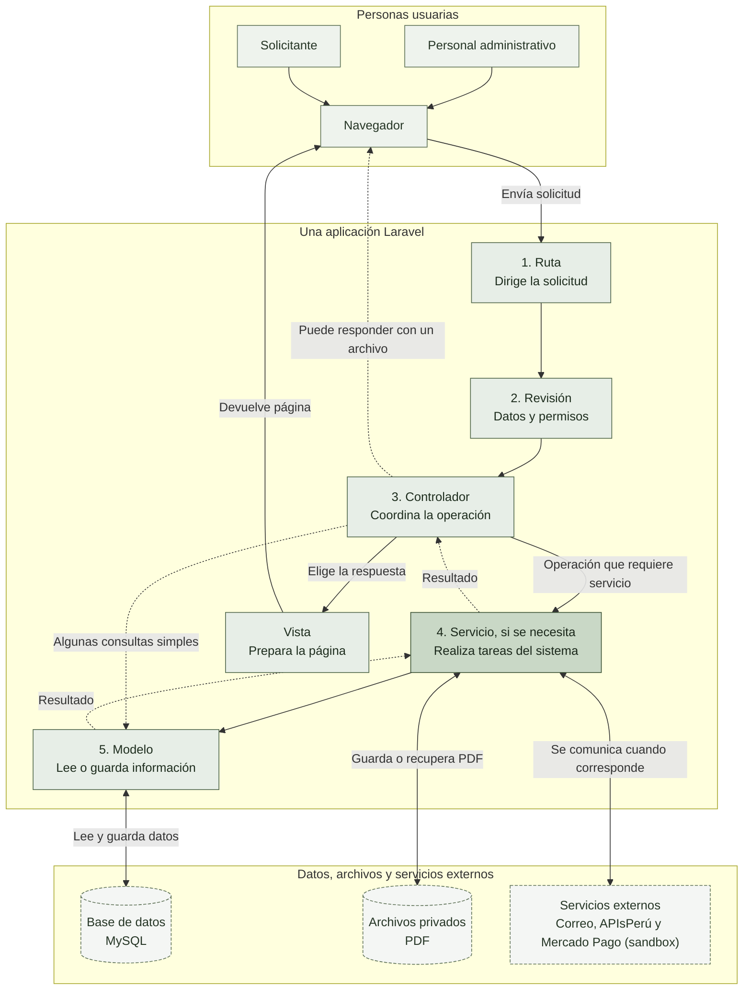
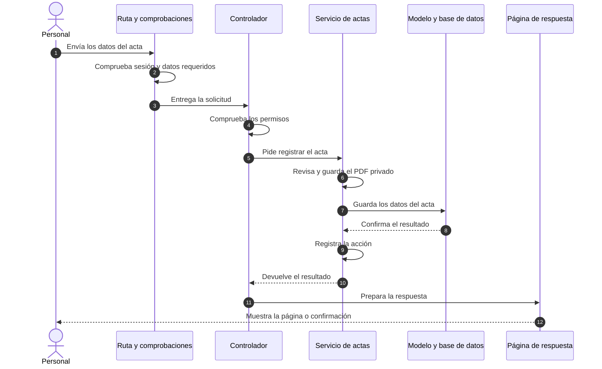

# Enfoque arquitectónico: MVC con servicios

## 1. ¿Cómo se organiza?

El sistema usa **MVC con servicios** dentro de Laravel. En palabras sencillas, cada parte tiene un trabajo principal:

1. El **navegador** envía una solicitud, por ejemplo, para buscar o registrar un acta.
2. Las **rutas y controles** la dirigen y comprueban datos y permisos.
3. El **controlador** coordina qué debe ocurrir y qué respuesta mostrar.
4. Los **servicios**, cuando la operación los necesita, realizan tareas como registrar un acta, revisar un PDF o comunicarse con un proveedor.
5. Los **modelos** consultan o guardan información en la base de datos.
6. La **vista** prepara la página que se devuelve al navegador.

| Término | En sencillo | En este sistema |
|---|---|---|
| **Modelo (M)** | Representa la información guardada y permite consultarla. | Actas, trámites y usuarios, mediante los modelos de Laravel. |
| **Vista (V)** | Es la página que ve la persona usuaria. | Plantillas Blade con Bootstrap. |
| **Controlador (C)** | Recibe una solicitud y coordina la respuesta. | Clases como `ActaController` y `PortalPublicoController`. |
| **Servicio** | Reúne tareas que pueden ser más elaboradas o reutilizables. | Clases como `ActaService` y `CodigoTramiteService`; la integración con Mercado Pago se gestiona desde el flujo de pagos. |
| **Ruta** | Indica a qué parte del sistema debe llegar una solicitud. | Direcciones configuradas por Laravel, por ejemplo, para consultar actas. |
| **Middleware** | Comprueba condiciones antes de dejar pasar una solicitud. | Controles como sesión, protección CSRF y límite de intentos. |
| **Form Request / Policy** | Reglas para revisar los datos recibidos / permisos para realizar una acción. | Clases Laravel usadas en algunas operaciones. |
| **Eloquent** | Herramienta de Laravel para leer y guardar datos sin escribir cada consulta SQL a mano. | Conecta los modelos del sistema con MySQL. |
| **Laravel Storage** | Herramienta para guardar y recuperar archivos. | Mantiene los PDF en almacenamiento privado. |

**Importante:** esta organización describe responsabilidades, no una separación rígida. Algunas consultas sencillas se hacen desde controladores a modelos y ciertas reglas también viven en controladores o modelos. Los servicios se usan donde aportan valor; no toda operación pasa obligatoriamente por uno.

---

## 2. Diagrama del enfoque MVC con servicios

Las flechas muestran el camino habitual, no una regla obligatoria para todos los casos. Por ejemplo, algunas consultas sencillas van directamente del controlador al modelo.

## 3. Matriz de responsabilidades de los elementos MVC

| Parte | Qué hace | Ejemplos |
|---|---|---|
| **Vista (V)** | Muestra formularios, resultados y estados. | `resources/views/actas/`, `portal/`, `reportes/`, `auth/`. |
| **Controlador (C)** | Recibe la solicitud, coordina comprobaciones y decide qué respuesta devolver. | `ActaController`, `PortalPublicoController`, `AtencionPublicaController`, `FiliacionController`, `ReporteController`, `EntregaDocumentoController`, `CanalEntregaController`, `PerfilController`, `IncidenciaController`. |
| **Servicio** | Realiza tareas específicas que se comparten o requieren varios pasos. | `ActaService`, `PdfValidationService`, `PdfStorageService`, `AuditoriaService`, `CodigoTramiteService`, `CruceParentescoService`, `FirmaDocumentoService`, `IncidenciaService`, `WhatsAppConsulta` e integración de pagos con Mercado Pago. |
| **Modelo (M)** | Representa y consulta los datos guardados. | `Acta`, `ActaNacimiento`, `ActaMatrimonio`, `ActaDefuncion`, `TramitePublico`, `PagoTramite`, `TramiteEvento`, `User`, `Auditoria`. |
| **Controles** | Revisan, según la operación, la sesión, los datos recibidos y los permisos. | Middleware, `StoreActaRequest`, `GuardarFiliacionRequest` y `ActaPolicy`. |
| **Datos y servicios externos** | Guardan información y archivos o permiten comunicarse con otros sistemas. | MySQL, almacenamiento privado, correo, APIsPerú y Mercado Pago en sandbox. |

Los controladores pueden consultar modelos directamente para algunas operaciones sencillas. No todas las acciones usan un servicio.

---

## 4. Ejemplo: registrar un acta

En este ejemplo, una **transacción** agrupa los cambios de datos para evitar que quede un registro a medias si algo falla. No todas las solicitudes del sistema siguen exactamente estos pasos.

---

## 5. Flujos representativos implementados

1. **Registro de acta documental:**
   - El controlador comprueba el permiso y los datos recibidos.
   - `ActaService` revisa el PDF y verifica si ya existe un archivo duplicado.
   - `PdfStorageService` guarda el archivo en un espacio privado.
   - El sistema guarda los datos del acta y registra la acción. Si falla el guardado en la base de datos, elimina el PDF que acababa de guardar.
2. **Trámite público y seguimiento:**
   - La búsqueda pública permite continuar solo si encuentra un acta coincidente y su PDF está disponible.
   - El sistema genera un código para hacer seguimiento al trámite. Su envío depende de que el correo esté configurado (`CodigoTramiteService`).
   - El trámite utiliza Mercado Pago en sandbox para pruebas; este entorno no procesa cobros reales de producción.
   - Tras la revisión humana y la carga del documento firmado, la solicitud pasa a estado `LISTA` (lista para entrega). Entonces se habilita la descarga protegida; el correo depende de la configuración y WhatsApp se gestiona manualmente.
3. **Filiación y revisión:**
   - El controlador revisa los datos de los padres y los permisos para editarlos, sin alterar el acta central ni su numeración oficial.
   - Se conserva el historial de cambios y el documento original. `CruceParentescoService` ofrece apoyo para la revisión del personal registrador; no reemplaza la revisión humana.

---

## 6. Estado y límites técnicos

- **Conectores externos:** `ApisPeruService` está implementado, pero falta probarlo con las claves reales del proveedor. Mercado Pago se utiliza en sandbox; su configuración de producción y los cobros reales quedan fuera de ese entorno.
- **Entorno de correo:** Configurado como `log` en desarrollo local (no realiza envíos SMTP reales a menos que se configure un servidor de correo).
- **Firma digital:** El personal firma el documento externamente con PeruFirma y luego carga el PDF al sistema, donde se comprueba técnicamente la firma. La aplicación no realiza la firma por medio de una integración web automática.
- **WhatsApp:** Utiliza enlaces preconstruidos (`https://wa.me/...`) para envío manual asistido por el operador, sin API oficial automatizada.
