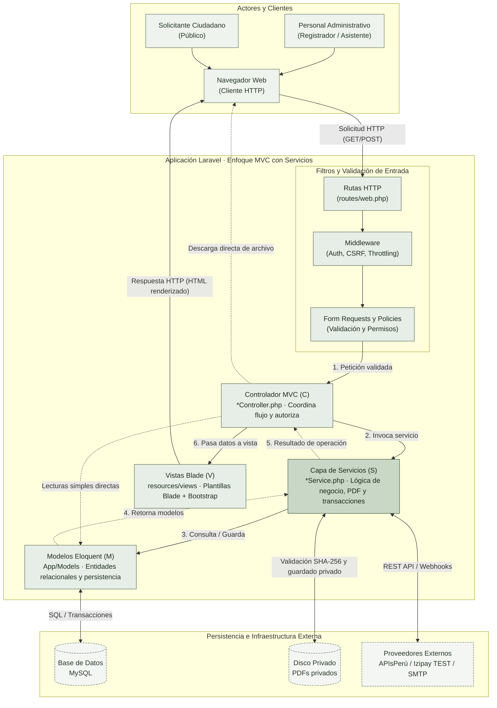
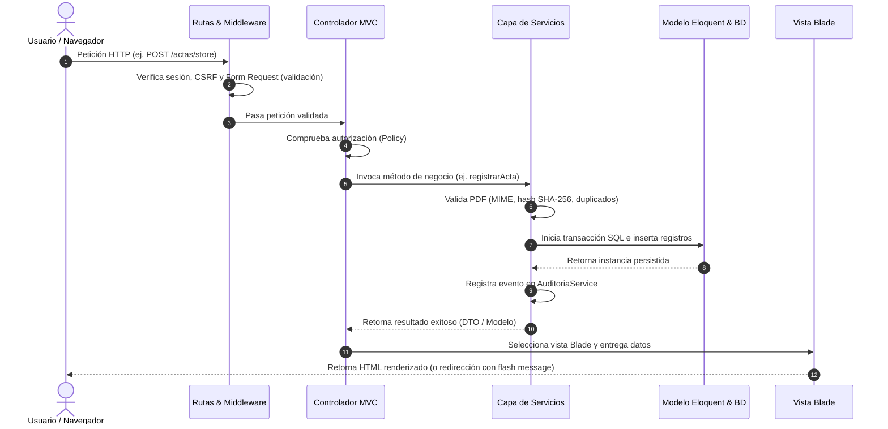

# Enfoque arquitectónico: MVC con servicios

## 1. Definición y propósito

El sistema del Registro Civil adopta el enfoque **MVC (Modelo - Vista - Controlador) complementado con una Capa de Servicios**, implementado sobre el framework **PHP / Laravel 11**. 

Este enfoque desacopla la presentación visual, la coordinación de peticiones y las reglas de negocio, permitiendo un mantenimiento ordenado sin abandonar las convenciones productivas de Laravel:
- **Modelo (M):** Representa las entidades del registro civil, sus relaciones, atributos y persistencia relacional mediante Eloquent ORM.
- **Vista (V):** Plantillas Blade enriquecidas con Bootstrap que generan la interfaz de usuario en el servidor (Server-Side Rendering).
- **Controlador (C):** Controladores delgados (*Thin Controllers*) que reciben la petición HTTP, coordinan la autorización y validación, delegan la lógica a los servicios y seleccionan la vista o respuesta correspondiente.
- **Capa de Servicios (S):** Clases de servicio dedicadas que encapsulan la lógica de negocio compleja, orquestación transaccional, cálculos de hash/validación de PDF y comunicaciones externas.

---

## 2. Diagrama del enfoque MVC con servicios

---

## 3. Matriz de responsabilidades de los elementos MVC

| Elemento | Rol en la arquitectura | Responsabilidad concreta | Ejemplos en el código del proyecto |
|---|---|---|---|
| **Vista (V)** | Presentación | Muestra formularios, resultados y estados; no accede a la base de datos ni decide permisos. | `resources/views/actas/`, `portal/`, `reportes/`, `auth/`. |
| **Controlador (C)** | Coordinación de flujo | Recibe peticiones, delega validación en Form Requests, autoriza mediante Policies, invoca servicios y retorna vistas o descargas. | `ActaController`, `PortalPublicoController`, `AtencionPublicaController`, `FiliacionController`, `ReporteController`, `EntregaDocumentoController`, `CanalEntregaController`, `PerfilController`, `IncidenciaController`. |
| **Servicios (S)** | Lógica de negocio y orquestación | Encapsula reglas de negocio, transacciones ACID, cálculo de hash SHA-256, validación de PDF y comunicación con pasarelas. | `ActaService`, `PdfValidationService`, `PdfStorageService`, `AuditoriaService`, `CodigoTramiteService`, `CruceParentescoService`, `FirmaDocumentoService`, `FirmaPeruService`, `IzipayService`, `IncidenciaService`, `WhatsAppConsulta`. |
| **Modelo (M)** | Dominio y datos | Mapea las tablas relacionales, relaciones (`hasOne`, `belongsTo`), scopes de consulta y validación de integridad a nivel de registro. | `Acta`, `ActaNacimiento`, `ActaMatrimonio`, `ActaDefuncion`, `TramitePublico`, `PagoTramite`, `TramiteEvento`, `User`, `Auditoria`. |
| **Controles transversales** | Seguridad y filtro | Autenticar usuarios, validar formato y reglas de entrada, proteger contra CSRF y limitar tasas de peticiones. | Middlewares Laravel (`auth`, `throttle`), Form Requests (`StoreActaRequest`, `GuardarFiliacionRequest`), Policies (`ActaPolicy`). |
| **Infraestructura** | Persistencia y servicios externos | Almacenar datos transaccionales, proteger PDFs fuera de la raíz pública y conectarse con servicios externos. | MySQL, disco `storage/app/private`, cliente Guzzle para `ApisPeruService` e `IzipayService`. |

> **Nota sobre consultas simples:** Las operaciones de lectura directa y filtros no críticos pueden ser consultadas por el Controlador directamente a los Modelos Eloquent sin requerir un Servicio intermedio, evitando capas vacías innecesarias. Toda operación de escritura, registro documental o validación de negocio sí pasa obligatoriamente por la Capa de Servicios.

---

## 4. Ciclo de vida de una petición en el enfoque MVC

---

## 5. Flujos representativos implementados

1. **Registro de acta documental:**
   - El controlador autoriza la acción y valida la entrada con `StoreActaRequest`.
   - `ActaService` valida el archivo PDF (MIME real, cabecera `%PDF`, tamaño, hash SHA-256 para prevenir duplicados).
   - Se guarda el archivo en almacenamiento privado mediante `PdfStorageService`.
   - Dentro de una transacción de base de datos se guarda el acta central, el detalle específico (nacimiento, matrimonio o defunción) y se invoca `AuditoriaService`. Si la base de datos falla, se compensa eliminando el PDF guardado.
2. **Trámite público y seguimiento:**
   - La búsqueda pública ciudadana restringe consultas a coincidencias unívocas y actas que tengan PDF disponible.
   - Se genera el trámite ciudadano con código de seguimiento seguro enviado por correo (`CodigoTramiteService`).
   - Se integra pasarela Izipay (modo TEST) validando firma HMAC e IPN del servidor antes de confirmar pagos.
   - Tras revisión humana y carga del documento firmado por el registrador, la solicitud pasa a estado `LISTA`, habilitando la descarga protegida y envío por correo/WhatsApp manual.
3. **Filiación y revisión:**
   - El controlador valida y autoriza la edición de progenitores sin alterar el acta central ni su numeración oficial.
   - Se mantiene un historial inmutable con versión y hash del documento original. `CruceParentescoService` asiste como herramienta de apoyo para la verificación del registrador.

---

## 6. Estado y límites técnicos

- **Conectores externos:** `ApisPeruService` se encuentra implementado pero pendiente de validación con credenciales reales en producción. `IzipayService` cuenta con integración en modo TEST verificada mediante HMAC e IPN.
- **Entorno de correo:** Configurado como `log` en desarrollo local (no realiza envíos SMTP reales a menos que se configure un servidor de correo).
- **Firma digital:** Implementada la vía de firma externa con subida manual de PDF y verificación CMS; el adaptador web directo de Firma Perú permanece disponible sin activación institucional formal.
- **WhatsApp:** Utiliza enlaces preconstruidos (`https://wa.me/...`) para envío manual asistido por el operador, sin API oficial automatizada.
