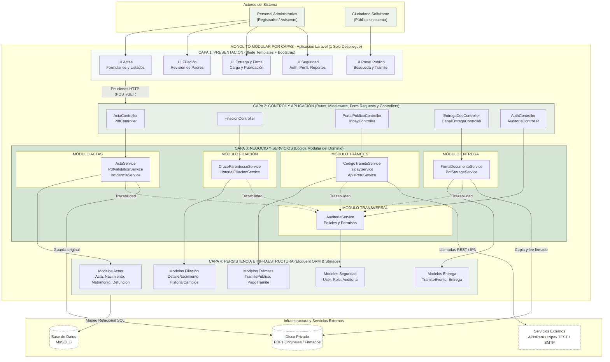

# Estilo arquitectónico: Monolítico Modular por Capas

## 1. Definición del estilo

El sistema del Registro Civil adopta el estilo arquitectónico **Monolítico Modular por Capas** (*Modular Layered Monolith*). Este estilo fusiona dos dimensiones organizativas fundamentales:

1. **Dimensión Monolítica (Unidad de despliegue unificada):**
   - El sistema completo (panel administrativo, trámites ciudadanos, lógica de negocio y persistencia) se empaqueta y ejecuta como **una única aplicación Laravel** en un único servidor/despliegue.
   - Comparte una única base de datos relacional MySQL y un almacenamiento privado local para archivos PDF.
   - Las comunicaciones entre componentes se resuelven como llamadas a métodos PHP en memoria, sin latencia de red, serialización costosa ni la complejidad operativa de microservicios distribuidos.

2. **Dimensión Modular (Eje Vertical - Dominios de negocio):**
   - El código se descompone en **módulos funcionales bien delimitados** según el dominio registral: *Actas Registrales*, *Filiación*, *Trámites Públicos y Pagos*, *Firma y Entrega*, y el módulo transversal de *Seguridad y Auditoría*.
   - Cada módulo encapsula sus responsabilidades y ofrece una interfaz clara a través de sus servicios, evitando acoplamientos innecesarios.

3. **Dimensión por Capas (Eje Horizontal - Niveles de abstracción):**
   - Dentro del monolito y a través de los módulos, se aplica una separación estricta en **cuatro capas horizontales** con dependencias unidireccionales (de arriba hacia abajo):
     - **Capa 1: Presentación (UI)**
     - **Capa 2: Control y Aplicación**
     - **Capa 3: Lógica de Negocio y Dominio (Servicios)**
     - **Capa 4: Persistencia e Infraestructura**

---

## 2. Diagrama arquitectónico: Monolítico Modular por Capas

---

## 3. Matriz de distribución: Módulos funcionales vs. Capas lógicas

| Módulo Funcional (Vertical) | Capa 1: Presentación | Capa 2: Control | Capa 3: Negocio y Servicios | Capa 4: Persistencia e Infraestructura |
|---|---|---|---|---|
| **1. Archivo y Actas Registrales** | Vistas Blade de actas: `resources/views/actas/*` (listado, registro, fichas, incidencias). | `ActaController.php`, `PdfController.php`, `IncidenciaController.php`, `StoreActaRequest.php`. | `ActaService.php` (registro transaccional), `PdfValidationService.php` (hash SHA-256, cabecera), `IncidenciaService.php`. | Modelos: `Acta`, `ActaNacimiento`, `ActaMatrimonio`, `ActaDefuncion`, `Incidencia`. `PdfStorageService` (`storage/app/private/`). |
| **2. Filiación y Parentesco** | Vistas de filiación: `resources/views/actas/filiacion.blade.php`. | `FiliacionController.php`, `GuardarFiliacionRequest.php`. | `CruceParentescoService.php` (asistencia analítica al registrador), control de versiones de filiación. | Modelo `ActaNacimiento`, tabla relacional de historial de revisiones de filiación. |
| **3. Trámites Públicos y Pagos** | Portal ciudadano: `resources/views/portal/*` (búsqueda, formulario sin cuenta, seguimiento). | `PortalPublicoController.php`, `IzipayController.php`, `AtencionPublicaController.php`. | `CodigoTramiteService.php` (código de un solo uso), `IzipayService.php` (firma HMAC, retorno e IPN), `ApisPeruService.php`. | Modelos: `TramitePublico`, `PagoTramite`. Configuración en `config/portal.php`. |
| **4. Firma Digital y Entrega** | Vistas de atención y entrega: `resources/views/entrega/*`. | `EntregaDocumentoController.php`, `CanalEntregaController.php`, `FirmaPeruController.php`. | `FirmaDocumentoService.php` (validación CMS de firma manual), `WhatsAppConsulta.php` (enlace manual asistido). | Modelos: `TramiteEvento`, copias firmadas en almacenamiento privado, logs de descarga autorizada. |
| **5. Seguridad y Auditoría (Transversal)** | Vistas de login, perfil y reportes: `resources/views/auth/*`, `reportes/*`. | `AuthController.php`, `PerfilController.php`, `ReporteController.php`, `AuditoriaController.php`. | `AuditoriaService.php` (trazabilidad de operaciones críticas), Policies de Laravel (`ActaPolicy.php`). | Modelos: `User`, `Role`, `Auditoria`, `PasswordResetToken`. Tablas de auditoría en MySQL. |

---

## 4. Reglas de diseño del estilo monolítico modular por capas

1. **Unidireccionalidad de las dependencias:** Las llamadas entre capas solo descienden (Presentación $\rightarrow$ Control $\rightarrow$ Negocio $\rightarrow$ Persistencia). Una capa inferior jamás invoca directamente a una capa superior.
2. **Encapsulamiento modular:** La lógica de negocio de un módulo reside en sus propios servicios. Si el Módulo de Trámites requiere registrar una acción, no modifica directamente las tablas de auditoría, sino que invoca a `AuditoriaService`.
3. **Consistencia transaccional ACID:** Al encontrarse todos los módulos en una misma base de datos MySQL, el registro de un acta, sus detalles y su evento de auditoría se ejecutan en una sola transacción local (`DB::transaction`). Si se produce un error, se compensa el almacenamiento físico del archivo PDF.
4. **Almacenamiento protegido:** Ningún archivo PDF original o firmado se ubica en el directorio público web (`public/`). El acceso siempre requiere autenticación o sesión de seguimiento autorizada con código vigente.
5. **Simplicidad operativa e institucional:** Al ser un monolito, no requiere orquestadores de contenedores (Kubernetes), colas complejas entre microservicios ni sincronización distribuida; un único backup unificado (MySQL + carpeta de almacenamiento) garantiza la recuperación total ante desastres.

---

## 5. Correspondencia con las Decisiones Arquitectónicas (ADR)

- **ADR-001 (Monolito con MVC y servicios):** Fundamento del despliegue unificado y bajo costo operacional.
- **ADR-002 (Blade y Bootstrap):** Capa de presentación homogénea para interfaz administrativa y portal público.
- **ADR-003 y ADR-004 (MySQL y Storage privado):** Persistencia relacional con transacciones y archivos PDF aislados del acceso web directo.
- **ADR-005 a ADR-008 (Gestión documental de actas):** Registro sin alterar originales, bloqueo de numeración oficial y control de duplicados por hash SHA-256.
- **ADR-009 (Auditoría transversal):** Trazabilidad obligatoria de acciones administrativas y ciudadanas.
- **ADR-013 y ADR-014 (Trámite sin cuentas y control de estados):** Proceso público desacoplado del acceso administrativo, con control estricto de transiciones (de `pendiente` a `LISTA`).
- **ADR-015 y ADR-017 (Firma externa y entrega controlada):** Flujo de firma con DNIe fuera de la web, verificación CMS y descarga solo en estado `LISTA`.
- **ADR-022 y ADR-023 (Pago Izipay y revisión de filiación):** Conector Izipay REST V4 en modo TEST y módulo de filiación con histórico inmutable.
