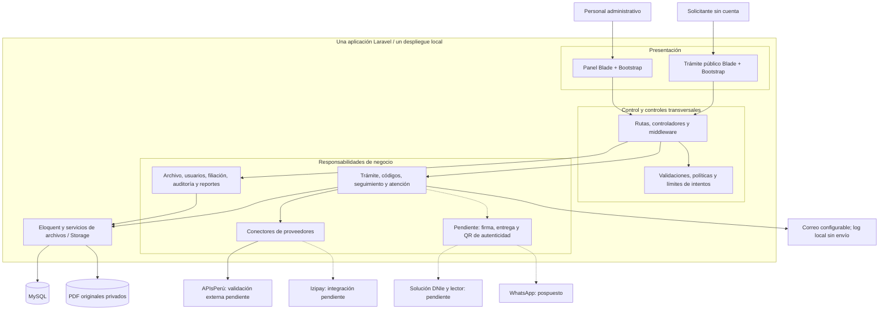

# Estilo arquitectónico del Registro Civil

## Estilo y enfoque interno

El sistema adopta un **estilo monolítico**, organizado por responsabilidades dentro de una aplicación Laravel. Su enfoque interno es **MVC con servicios**, con controles transversales de validación, autorización y auditoría.

| Aspecto | Aplicación en Registro Civil |
|---|---|
| Unidad de despliegue | Una aplicación Laravel contiene panel administrativo y trámite público. MySQL y almacenamiento privado respaldan la persistencia. |
| Presentación | Vistas Blade, Bootstrap y JavaScript; Laravel produce el HTML. |
| Control | Rutas, controladores y middleware coordinan peticiones; Form Requests y políticas apoyan validación y autorización. |
| Negocio y servicios | Servicios de registro, PDF, códigos, búsqueda, auditoría y proveedores, junto con reglas existentes en controladores y modelos. |
| Persistencia | Modelos Eloquent, MySQL y Laravel Storage. Los archivos privados se consultan mediante rutas autorizadas. |
| Integraciones | Correo y conectores HTTP desde el servidor. APIsPerú requiere validación externa; Izipay está seleccionado y pendiente de integración. |
| Consecuencias | Un despliegue facilita operación y mantenimiento iniciales; los cambios comparten aplicación y base y requieren comprobar regresiones. Los servicios dependen de Laravel y Eloquent. |

La organización por responsabilidades ayuda a mantener el sistema, pero no supone independencia completa entre capas ni demuestra por sí sola capacidad o disponibilidad. Las metas se verifican según los [atributos de calidad](../analisis-de-sistema/04-atributos-de-calidad.md).

## Diagrama del estilo

Las líneas discontinuas indican funciones futuras. Los bloques agrupan responsabilidades: no representan aplicaciones separadas ni implican una clase o servicio independiente para cada bloque.

## Correspondencia con las decisiones

- ADR-001 a ADR-004 sustentan aplicación Laravel, interfaz, datos relacionales y almacenamiento privado.
- ADR-013 y ADR-014 describen el trámite actual sin cuentas y la atención con transiciones y versión controladas. Las cuentas y solicitudes anteriores se conservan por compatibilidad histórica.
- ADR-021 describe el conector APIsPerú pendiente de validación externa; ADR-022 registra la selección de Izipay, cuya integración está pendiente.
- ADR-023 permite revisar filiación con historial sin modificar el acta central, su numeración ni el PDF original.
- ADR-015 a ADR-019 mantienen como pendientes firma, autenticidad, entrega, notificaciones futuras y respaldo operativo; WhatsApp permanece pospuesto.

## Evolución prevista

La separación nube/municipalidad y la sincronización aún no existen y no se incorporan a la vista actual como infraestructura operativa. El futuro diseño de firma y entrega deberá preservar originales y definir autorización y evidencia. La aprobación administrativa actual no genera documentos firmados ni habilita descargas.

Véanse el [enfoque MVC con servicios](enfoque-arquitectonico.md) y el [registro de decisiones](../analisis-de-sistema/07-decisiones-arquitectonicas.md).
