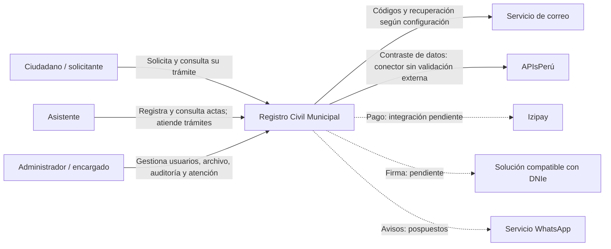

# Nivel 1 · Diagrama de contexto del sistema

> Proyecto: Registro Civil · Modelo: C4 · Nivel 1 de 4 · Versión: 1.0.

## 1. Objetivo

Mostrar el sistema como una unidad, las personas que lo usan y sus relaciones con proveedores.

| Aspecto | Descripción |
|---|---|
| Pregunta que responde | ¿Quién usa Registro Civil y con qué sistemas externos se comunica? |
| Audiencia | Personal municipal, docente y equipo de desarrollo. |
| Qué no muestra | Clases, módulos, base de datos ni infraestructura interna. |
| Siguiente nivel | [Contenedores](Nivel2-DiagramadeContenedores.md). |

## 2. Diagrama

Las líneas discontinuas representan relaciones futuras. El lector DNIe es un dispositivo de apoyo de la solución de firma y no una persona usuaria. El correo `log` local no comunica con un proveedor externo.

## 3. Personas (usuarios)

| Persona | Descripción | Qué hace en el sistema |
|---|---|---|
| Ciudadano / solicitante | Persona que inicia una solicitud de copia. | Inicia trámite sin crear cuenta, declara datos y vínculo y consulta seguimiento con código. Descarga y validación de autenticidad pendientes. |
| Asistente | Personal municipal autorizado. | Registra actas existentes, revisa filiación, consulta archivo y reportes permitidos y atiende trámites. |
| Administrador / encargado | Responsable administrativo. | Gestiona cuentas y consulta auditoría, además de funciones del archivo. Firma DNIe pendiente. |

## 4. Sistemas

| Sistema | Tipo | Responsabilidad | Quién lo construye |
|---|---|---|---|
| Registro Civil | Sistema en alcance | Archivo documental y atención del trámite público. | Equipo del proyecto. |
| Servicio de correo | Externo | Transportar códigos y enlaces de recuperación cuando se configure envío real. | Proveedor seleccionado para correo. |
| APIsPerú | Externo | Contraste de DNI y nombres; no acredita identidad ni parentesco. | Proveedor externo. |
| Izipay | Externo seleccionado | Procesamiento de pagos, pendiente de integración. | Proveedor de pagos. |
| Solución DNIe | Componente externo previsto | Firma y validación criptográfica, pendiente de seleccionar e integrar. | Proveedor por definir. |
| Servicio WhatsApp | Externo previsto | Notificaciones; integración pospuesta. | Proveedor por definir. |

## 5. Relaciones

| Origen | Destino | Descripción | Protocolo |
|---|---|---|---|
| Ciudadano | Registro Civil | Trámite y seguimiento. | — |
| Asistente y administrador | Registro Civil | Operaciones autorizadas del archivo y atención. | — |
| Registro Civil | Correo | Códigos y recuperación. | Transporte configurable; SMTP para envío real. |
| Registro Civil | APIsPerú | Contraste de datos. | HTTPS. |
| Registro Civil | Izipay | Pago y confirmación verificada previstos. | Contrato técnico por definir según modalidad elegida. |
| Registro Civil | Solución DNIe | Firma y evidencia previstas. | Por definir. |
| Registro Civil | WhatsApp | Avisos futuros. | Por definir; pospuesto. |

## 6. Decisiones y supuestos

| # | Decisión o supuesto | Motivo |
|---|---|---|
| 1 | El solicitante no accede al archivo administrativo. | Privacidad y autorización de documentos. |
| 2 | Pago, contraste y parentesco no autorizan por sí solos una entrega. | Se requiere decisión humana y proceso de entrega aún pendiente. |
| 3 | La aprobación no equivale a firma ni descarga. | Reflejar el alcance actual del desarrollo. |

### Pendientes por definir

| Tema | Detalle |
|---|---|
| Izipay | Modalidad, credenciales, contrato de confirmación y validación en pruebas. |
| Firma y entrega | Solución compatible, autorización, evidencia y descarga privada. |
| Operación | Reglas municipales, correo real, publicación y respaldo operativo. |
