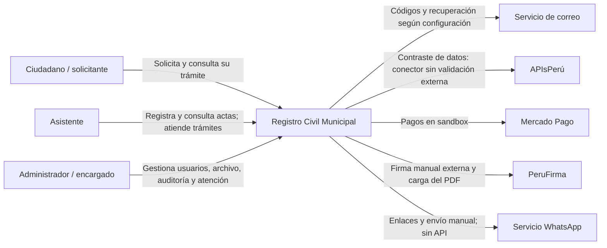

# Nivel 1 · Diagrama de contexto del sistema

> Proyecto: Registro Civil · Modelo: C4 · Nivel 1 de 4 · Versión: 1.1.

## 1. Objetivo

Mostrar el sistema como una unidad, las personas que lo usan y sus relaciones con proveedores.

| Aspecto | Descripción |
|---|---|
| Pregunta que responde | ¿Quién usa Registro Civil y con qué sistemas externos se comunica? |
| Audiencia | Personal municipal, docente y equipo de desarrollo. |
| Qué no muestra | Clases, módulos, base de datos ni infraestructura interna. |
| Siguiente nivel | [Contenedores](Nivel2-DiagramadeContenedores.md). |

## 2. Diagrama

Las relaciones incluyen funciones locales implementadas; Mercado Pago se usa en sandbox, no para cobros reales de producción. La firma se realiza externamente con PeruFirma y luego se carga el PDF firmado. El correo `log` local no comunica con un proveedor externo.

## 3. Personas (usuarios)

| Persona | Descripción | Qué hace en el sistema |
|---|---|---|
| Ciudadano / solicitante | Persona que inicia una solicitud de copia. | Inicia trámite sin cuenta, declara datos y vínculo y consulta solicitudes con DNI, correo y código. Puede pagar en el entorno sandbox de Mercado Pago, elegir canales y descargar el firmado publicado como LISTA; QR público pendiente. |
| Asistente | Personal municipal autorizado. | Registra actas existentes, revisa filiación, consulta archivo y reportes permitidos y atiende trámites; consulta incidencias y gestiona perfil. Puede cargar y publicar documentos firmados según las rutas internas actuales. |
| Administrador / encargado | Responsable administrativo. | Gestiona cuentas y consulta auditoría, además de funciones del archivo. Puede cargar y publicar PDF firmados externamente con PeruFirma. |

## 4. Sistemas

| Sistema | Tipo | Responsabilidad | Quién lo construye |
|---|---|---|---|
| Registro Civil | Sistema en alcance | Archivo documental y atención del trámite público. | Equipo del proyecto. |
| Servicio de correo | Externo | Transportar códigos, enlaces de recuperación y PDF firmado adjunto cuando el envío esté configurado y la entrega publicada. | Proveedor seleccionado para correo. |
| APIsPerú | Externo | Contraste de DNI y nombres; no acredita identidad ni parentesco. | Proveedor externo. |
| Mercado Pago | Externo seleccionado | Integración de pagos utilizada en entorno sandbox; no procesa cobros reales de producción. | Proveedor de pagos. |
| PeruFirma | Componente externo | Firma manual externa; el PDF firmado se carga luego al sistema y se revisa antes de publicarlo. | Proveedor de firma digital. |
| WhatsApp manual | Externo | Consultas y envío manual del documento mediante enlaces; sin API ni envío automático. | Servicio WhatsApp. |

## 5. Relaciones

| Origen | Destino | Descripción | Protocolo |
|---|---|---|---|
| Ciudadano | Registro Civil | Trámite, seguimiento por DNI y correo, selección de solicitudes, canales y descarga del documento publicado. | — |
| Asistente y administrador | Registro Civil | Operaciones autorizadas del archivo y atención. | — |
| Registro Civil | Correo | Códigos, recuperación y PDF firmado adjunto según preferencias. | Transporte configurable; SMTP para envío real. |
| Registro Civil | APIsPerú | Contraste de datos. | HTTPS. |
| Registro Civil | Mercado Pago | Pagos en entorno sandbox. | Integración de pagos de Mercado Pago. |
| Registro Civil | PeruFirma | Firma externa y carga posterior del PDF firmado. | Intercambio manual de PDF. |
| Registro Civil | WhatsApp | Consulta y entrega manual. | Enlaces HTTPS wa.me; envío efectuado por la persona. |

## 6. Decisiones y supuestos

| # | Decisión o supuesto | Motivo |
|---|---|---|
| 1 | El solicitante no accede al archivo administrativo. | Privacidad y autorización de documentos. |
| 2 | Pago, contraste y parentesco no autorizan por sí solos una entrega. | Se requiere aprobación, firma verificada, revisión expresa y publicación; LISTA no acredita descarga o recepción. |
| 3 | La aprobación no equivale a firma ni descarga. | Reflejar el alcance actual del desarrollo. |

### Pendientes por definir

| Tema | Detalle |
|---|---|
| Mercado Pago | Validar el flujo de pagos en sandbox; no habilitar cobros reales de producción sin la configuración y aprobación correspondientes. |
| Firma y entrega | PeruFirma se usa fuera del sistema y luego se carga el PDF. Confianza, revocación y facultades requieren revisión humana; rutas actuales admiten ambos roles internos. |
| Operación | Reglas municipales, correo real, publicación y respaldo operativo. |
