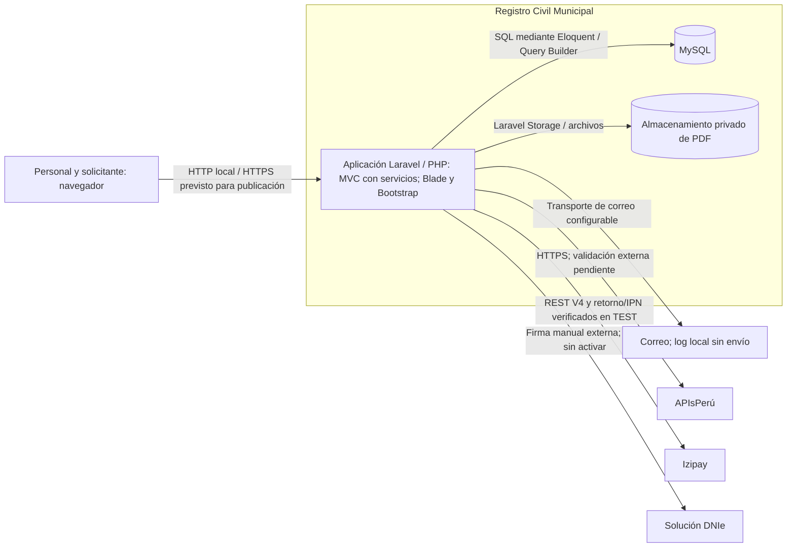

# Nivel 2 · Diagrama de contenedores

> Proyecto: Registro Civil · Modelo: C4 · Nivel 2 de 4 · Versión: 1.1.

## 1. Objetivo

Mostrar la aplicación y los almacenes de datos que componen el sistema. «Contenedor» es una unidad ejecutable o almacén, no implica Docker.

| Aspecto | Descripción |
|---|---|
| Pregunta que responde | ¿Qué unidades componen el sistema y cómo se comunican? |
| Audiencia | Equipo de desarrollo y operación. |
| Qué es un contenedor | Una aplicación ejecutable o almacén de datos con responsabilidad definida. |
| Nivel anterior | [Contexto](Nivel1-DiagramadeContextodelSistema.md). |
| Siguiente nivel | [Componentes](Nivel3-Diagrama-de-Componentes.md). |

## 2. Diagrama

## 3. Contenedores

| Contenedor | Tecnología | Responsabilidad | Datos que maneja |
|---|---|---|---|
| Aplicación Registro Civil | PHP y Laravel, Blade y Bootstrap | Renderizar panel y portal, coordinar reglas, controles e integraciones. | Sesión y datos de petición; persiste mediante MySQL y Storage. |
| Base de datos | MySQL | Conservar registros relacionales y sus restricciones. | Usuarios y foto, actas y detalles, auditoría, filiación, trámites, pagos y eventos; solicitudes anteriores y metadata de entrega/canales dentro de datos cifrados. |
| Almacenamiento privado | Sistema de archivos mediante Laravel Storage | Conservar PDF fuera del acceso público directo. | Documentos originales, versiones firmadas privadas y fotos de perfil; metadata de entrega en datos cifrados del trámite. |

El almacenamiento de archivos se representa como almacén lógico, no como servidor adicional. Blade forma parte de Laravel; no hay SPA ni API separada obligatoria, caché Redis o microservicios en esta vista. Las pruebas SQLite no sustituyen a MySQL como persistencia del sistema.

## 4. Relaciones

| Origen | Destino | Descripción | Protocolo |
|---|---|---|---|
| Navegador | Aplicación | Formularios, consultas y respuestas HTML. | HTTP local; HTTPS requerido al publicar. |
| Aplicación | MySQL | Lectura, escritura y transacciones. | SQL mediante conexión configurada. |
| Aplicación | Almacenamiento privado | Guardar y servir PDF con autorización. | Operaciones de archivos mediante Storage. |
| Aplicación | Correo | Códigos, recuperación y PDF firmado adjunto según preferencias. | Transporte configurable; `log` no envía. |
| Aplicación | APIsPerú | Contraste desde servidor. | HTTPS. |
| Aplicación | Izipay | Pagos TEST con formToken y confirmación verificada. | HTTPS / Mi Cuenta Web REST V4. |
| Aplicación | Firma Perú / DNIe | Firma manual externa; adaptador web sin activar. | PDF manual; protocolo web existente pendiente de activación institucional. |

## 5. Decisiones arquitectónicas reflejadas

| Decisión | Alternativa descartada | Motivo |
|---|---|---|
| Una aplicación Laravel | Separar funciones en microservicios en esta versión. | Mantener la arquitectura y operación actual del proyecto. |
| Blade dentro de Laravel | Trasladar la SPA del marketplace. | El sistema usa renderizado del servidor. |
| MySQL relacional | Adoptar la base del proyecto de referencia. | Conservar persistencia y restricciones existentes. |
| PDF privado en archivos | Publicar originales o almacenarlos como BLOB. | Controlar acceso y separar archivos de metadatos. |

## 6. Seguridad entre contenedores

| Comunicación | Medida |
|---|---|
| Navegador → aplicación | Sesión y autorización del servidor; CSRF en formularios y límites de intentos según ruta. HTTPS público pendiente de despliegue. |
| Aplicación → MySQL | Credenciales por entorno y datos del trámite cifrados por la aplicación. |
| Aplicación → archivos | PDF privados entregados por rutas autorizadas. |
| Aplicación → proveedores | Secretos en servidor, TLS verificado y validación de respuestas. Izipay TEST verifica retorno e IPN; producción y operación interactiva completa pendientes. El adaptador web de firma utiliza capacidades limitadas por intento y vencimiento. |

La separación nube/municipalidad y sincronización permanecen pendientes y no se representan como contenedores operativos.
