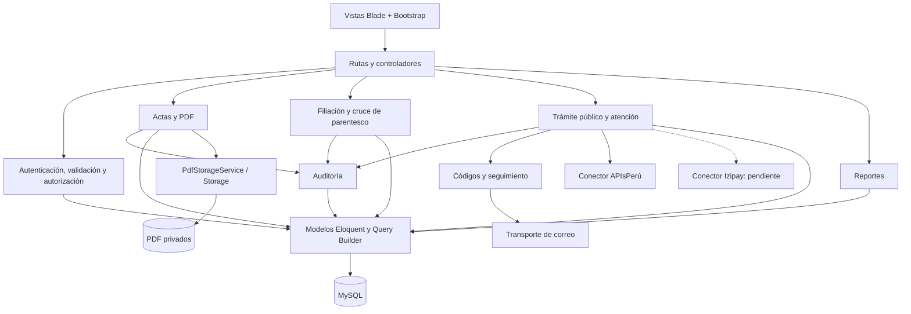

# Nivel 3 · Diagrama de componentes

> Proyecto: Registro Civil · Contenedor detallado: aplicación Laravel · Modelo: C4 · Nivel 3 de 4 · Versión: 1.0.

## 1. Objetivo

Describir los componentes internos que colaboran dentro del mismo despliegue Laravel.

| Aspecto | Descripción |
|---|---|
| Pregunta que responde | ¿Cómo se organiza la aplicación por dentro? |
| Audiencia | Equipo de desarrollo. |
| Qué es un componente | Agrupación de responsabilidades y clases; no implica un proceso separado. |
| Nivel anterior | [Contenedores](Nivel2-DiagramadeContenedores.md). |
| Siguiente nivel | [Código](Nivel4-DiagramadeCodigo.md). |

## 2. Diagrama

## 3. Componentes

| Componente | Responsabilidad | Funcionalidades principales | Carpeta en el código |
|---|---|---|---|
| Presentación y entrada HTTP | Interacción y coordinación de peticiones. | Formularios, listados, respuestas y rutas protegidas. | `resources/views/`, `routes/`, `app/Http/Controllers/`. |
| Identidad y autorización | Control de acceso. | Login, roles, recuperación administrativa, validación y políticas. | `app/Http/Middleware/`, `app/Http/Requests/`, `app/Policies/`; controladores Auth, Usuario y PasswordReset. |
| Actas y PDF | Archivo de documentos existentes. | Registro, búsqueda, duplicados, numeración, visualización e impresión. | `app/Services/ActaService.php`, servicios PDF, controladores Acta y Pdf, `app/Models/`. |
| Filiación | Transcripción de datos de padres y apoyo a revisión. | Estados de dato, versión, historial y cruce de parentesco. | `FiliacionController.php`, `GuardarFiliacionRequest.php`, `CruceParentescoService.php`, `ActaNacimiento.php`. |
| Trámite público y atención | Solicitud sin cuenta y revisión humana. | Búsqueda controlada, términos, datos cifrados, estados y decisiones. | Controladores PortalPublico y AtencionPublica; `BusquedaPublicaService.php`, `DeclaracionSolicitud.php`, modelos de trámite. |
| Códigos y seguimiento | Autorización temporal de consulta. | Generación, envío y verificación del código de correo. | `app/Services/CodigoTramiteService.php`, `app/Mail/`. |
| Auditoría | Trazabilidad de operaciones. | Registro de acción y contexto; consulta administrativa. | `AuditoriaService.php`, `AuditoriaController.php`, modelo Auditoria. |
| Reportes | Información filtrada del archivo y actividad. | Resúmenes, pendientes, sobres y exportaciones. | `ReporteController.php`, `ReporteRequest.php`, vistas de reportes. |
| Conector de contraste | Comunicación con APIsPerú. | Contraste de DNI y nombres, validación externa pendiente. | `ApisPeruService.php`, `PortalHttpOptions.php`. |

Las rutas abreviadas se resuelven en las carpetas Laravel convencionales. `Solicitud` y `SolicitudEvento` conservan el flujo anterior con cuentas. Izipay, firma DNIe, entrega y QR de autenticidad son componentes pendientes; WhatsApp está pospuesto.

## 4. Relaciones entre componentes

| Origen | Destino | Descripción | Tipo de comunicación |
|---|---|---|---|
| Rutas / controladores | Autorización y validación | Comprobar entrada, sesión y permisos. | Llamada dentro de Laravel. |
| ActaController | ActaService | Registrar y buscar documentos. | Llamada PHP con servicios inyectados. |
| ActaService | Servicios PDF y auditoría | Validar, almacenar y registrar la operación. | Llamada PHP. |
| Filiación | Cruce de parentesco / auditoría | Apoyar revisión y guardar historial. | Llamada PHP y persistencia. |
| Trámite | Códigos / contraste | Verificar acceso al correo y contrastar datos. | Llamada PHP; contraste usa HTTPS externo. |
| Controladores / servicios | Modelos | Consultar y persistir datos. | Eloquent / Query Builder. |

## 5. Relaciones con contenedores y sistemas externos

| Componente | Destino | Descripción | Protocolo | Patrón aplicado |
|---|---|---|---|---|
| Modelos y consultas | MySQL | Datos relacionales y transacciones. | SQL. | Active Record para Eloquent; no se afirma Repository propio. |
| Servicios PDF | Archivos privados | Conservar originales. | Operaciones de archivos. | Servicio sobre Laravel Storage. |
| Códigos / recuperación | Correo | Transportar mensajes si está configurado. | Transporte configurable. | Servicios y facilidades de correo Laravel. |
| Contraste | APIsPerú | Validar datos del proveedor. | HTTPS. | Adaptación mediante servicio concreto. |
| Futuro componente de pagos | Izipay | Procesar y confirmar pagos. | Por definir según modalidad. | Adapter previsto, pendiente de implementar. |

## 6. Reglas de la aplicación monolítica

| # | Regla | Motivo |
|---|---|---|
| 1 | Las funciones actuales se despliegan en la misma aplicación Laravel. | Mantener la unidad de operación existente. |
| 2 | Las vistas no sustituyen la autorización del servidor. | Evitar accesos o decisiones basados solo en interfaz. |
| 3 | Servicios y modelos pueden depender de Laravel y Eloquent. | Describir MVC con servicios tal como existe. |
| 4 | La base es compartida; no se impone propiedad exclusiva de tablas por módulo. | Reflejar las relaciones y consultas reales. |
| 5 | La integración pendiente de Izipay no debe declararse operativa. | Separar decisión de proveedor de implementación y validación. |
