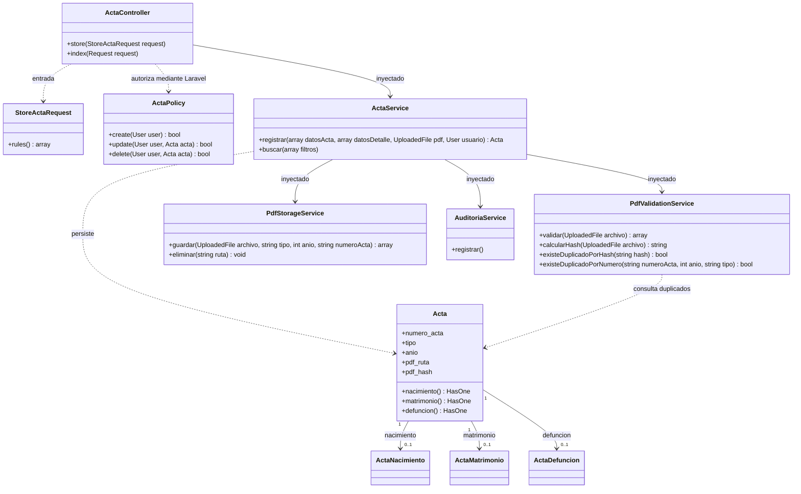
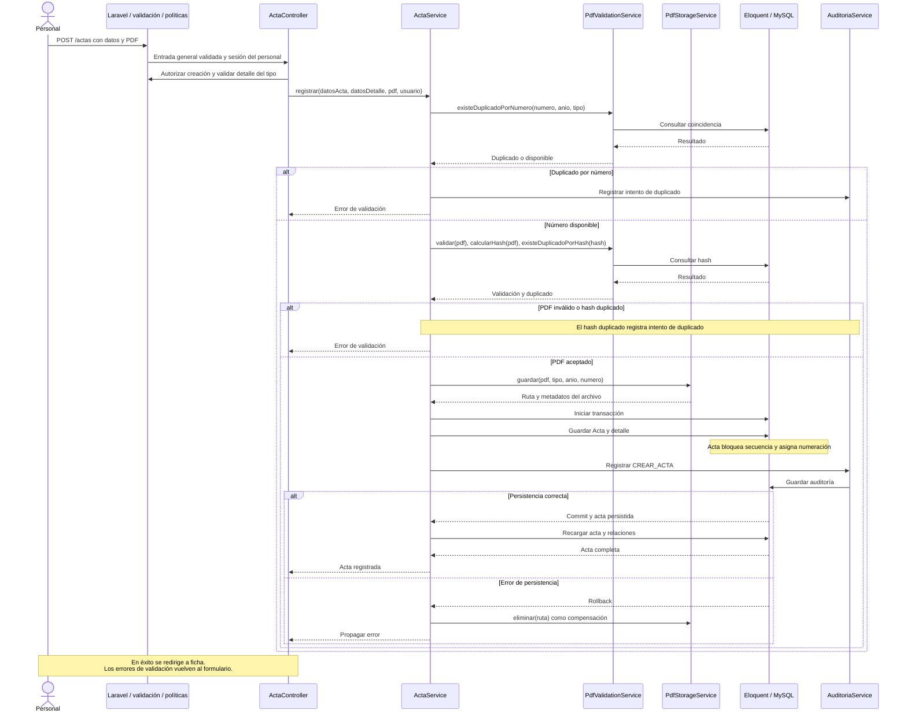

# Nivel 4 · Diagrama de código

> Proyecto: Registro Civil · Módulo detallado: Actas y PDF · Modelo: C4 · Nivel 4 de 4 · Notación: UML · Versión: 1.0.

## 1. Objetivo

Detallar las clases y colaboraciones del registro de un acta existente con PDF. Se describe el desarrollo actual, sin inventar clases para la integración Izipay pendiente.

| Aspecto | Descripción |
|---|---|
| Pregunta que responde | ¿Qué clases intervienen en el registro y cómo colaboran? |
| Audiencia | Desarrolladores. |
| Notación | Clases y secuencia UML expresadas en Mermaid. |
| Por qué este módulo | Reúne validación, permisos, almacenamiento, transacción, numeración y auditoría. |
| Nivel anterior | [Componentes](Nivel3-Diagrama-de-Componentes.md). |

## 2. Diagrama de clases

Se muestran miembros relevantes, no todas las firmas ni propiedades. Solo el detalle correspondiente al tipo se crea en el registro normal. Las relaciones expresan asociación Eloquent, sin atribuir composición o interfaces inexistentes.

### 2.1 Responsabilidades MVC con servicios

| Capa | Contiene | Regla |
|---|---|---|
| Presentación | Blade y Bootstrap. | Mostrar formularios y resultados. |
| Control | Controlador, validaciones y autorización. | Coordinar la petición y aplicar controles de entrada y acceso. |
| Servicios | Registro, validación PDF, almacenamiento y auditoría. | Coordinar operaciones; dependencia de Laravel explícita. |
| Modelo / persistencia | Eloquent y datos relacionales. | Conservar registros y relaciones en MySQL. |

### 2.2 Clases del módulo Actas

| Clase | Tipo | Capa | Responsabilidad |
|---|---|---|---|
| ActaController | Controlador | Control | Recibir y coordinar registro y consulta. |
| StoreActaRequest y Requests por tipo | Validación | Control | Validar reglas generales y específicas. |
| ActaPolicy | Política | Autorización | Controlar operaciones del personal. |
| ActaService | Servicio | Servicios | Coordinar duplicados, PDF, transacción y detalle. |
| Acta | Modelo | Persistencia | Datos centrales y numeración con bloqueo de secuencia. |
| ActaNacimiento, ActaMatrimonio, ActaDefuncion | Modelos | Persistencia | Datos específicos del tipo de acta. |

### 2.3 Clases de apoyo documental

| Clase | Tipo | Capa | Responsabilidad |
|---|---|---|---|
| PdfValidationService | Servicio | Servicios | Extensión, MIME, tamaño, cabecera y hash. |
| PdfStorageService | Servicio | Servicios | Nombre físico, guardado y compensación del archivo. |
| AuditoriaService | Servicio | Servicios | Registrar la operación. |

### 2.4 Notación UML utilizada

| Símbolo | Significado | Ejemplo |
|---|---|---|
| Flecha continua | Asociación o colaborador. | ActaService → PdfStorageService. |
| Flecha discontinua | Uso o dependencia. | PdfValidationService → Acta. |
| Multiplicidad | Cantidad de registros relacionados. | Acta → cero o un detalle de cada clase. |
| `+` | Miembro público mostrado. | `registrar`. |

## 3. Diagrama de secuencia: registrar acta

| Paso | Origen → destino | Acción |
|---|---|---|
| 1 | Personal → Laravel | Enviar datos y PDF mediante ruta protegida. |
| 2 | Controlador → validación / política | Validar datos específicos y autorizar creación. |
| 3 | Servicio → validación PDF | Rechazar número repetido, PDF inválido o hash duplicado. |
| 4 | Servicio → Storage | Guardar PDF con nombre generado. |
| 5 | Servicio → Eloquent / MySQL | Guardar acta, numeración, detalle y auditoría en transacción. |
| 6 | Alternativa de fallo | Revertir datos e intentar eliminar el archivo ya guardado. |
| 7 | Controlador → navegador | Redirigir a la ficha si el registro termina correctamente. |

El guardado del archivo precede a la transacción; su eliminación es compensación, no atomicidad entre MySQL y sistema de archivos. La cabecera `%PDF-` es un control de formato, no una validación criptográfica o análisis completo del documento. El hash sirve para integridad y duplicados, no sustituye una firma.

## 4. Patrones y principios que se ven en este nivel

| Elemento del diagrama | Patrón o principio |
|---|---|
| Vista, controlador y modelos | MVC. |
| ActaService y servicios PDF | Service Layer y separación de responsabilidades. |
| Modelos Eloquent | Active Record. |
| Colaboradores por constructor | Inyección de dependencias concretas. |
| Validación, almacenamiento y auditoría separados | Responsabilidad única aplicada parcialmente. |

La edición ordinaria y eliminación del acta están denegadas por política. Filiación es una operación distinta con campos limitados, versión e historial. El flujo aquí representado no firma, entrega ni procesa pagos. Véanse los [patrones](../diseño-de-software/diseño-interno/patrones-de-diseño.md) y [principios](../diseño-de-software/diseño-interno/principios-de-diseño.md).
