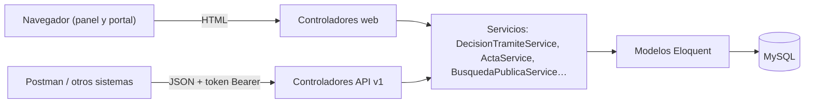

# Sprint 2 · Actividad 4 — API REST documentada con OpenAPI/Swagger

## 1. Qué se implementó

Una **API REST v1** dentro de la misma aplicación Laravel (monolito modular por capas, ADR-029). No es
otro sistema: es otra «puerta de entrada» (capa de presentación JSON) que usa los mismos servicios que el
panel web.



| Método | Ruta | Acceso | Qué hace |
|---|---|---|---|
| GET | `/api/v1/salud` | Público | Estado de la base de datos y el almacenamiento |
| POST | `/api/v1/consultas/disponibilidad` | Público (5 por minuto) | Dice si un acta está disponible, sin revelar datos |
| POST | `/api/v1/auth/token` | Público (con usuario y clave) | Entrega un token Bearer al personal; caduca en 8 h |
| GET | `/api/v1/auth/yo` | Token | Datos del usuario del token |
| DELETE | `/api/v1/auth/token` | Token | Revoca el token (cerrar sesión) |
| GET | `/api/v1/actas` | Token | Busca actas (filtros, 15 por página) |
| GET | `/api/v1/actas/{acta}` | Token | Detalle de un acta (sin el PDF) |
| GET | `/api/v1/tramites` | Token | Bandeja de solicitudes pagadas |
| GET | `/api/v1/tramites/{tramite}` | Token | Detalle con historial y transiciones |
| POST | `/api/v1/tramites/{tramite}/decision` | Token | Aprobar, observar o rechazar (409 si otra persona decidió antes) |

**Contrato:** [`codigo/docs/api/openapi.yaml`](../codigo/docs/api/openapi.yaml) (OpenAPI 3.0.3).
**Swagger UI:** `http://127.0.0.1:8010/api/documentacion` (con el servidor iniciado).

## 2. Decisiones de diseño

| Decisión | Por qué |
|---|---|
| La regla de decidir un trámite se movió a `DecisionTramiteService` | El panel web y la API usan **la misma** regla (SRP de SOLID, patrón Service Layer). El controlador web pasó de ~30 líneas a 4. |
| Validación en `DecidirTramiteRequest` (Form Request) | Una sola validación para web (redirige con errores) y API (responde 422 JSON). |
| `ConflictoVersionException` | El mismo conflicto se muestra como error en la web y como **409 Conflict** en la API. |
| Tokens con Laravel Sanctum, caducidad de 8 h y revocables | Una API no usa cookies; el token se puede cerrar y no sirve para siempre. |
| La API siempre responde JSON (`ForzarRespuestaJson`) | Sin token responde 401 JSON, nunca una redirección a la página de login. |
| Privacidad por diseño (`ActaResource`, `TramiteResource`) | Nunca devuelve PDF, rutas, código de acceso del ciudadano, correo ni DNI. |
| Prueba de contrato (`ContratoOpenApiTest`) | Si alguien agrega una ruta sin documentarla (o documenta una que no existe), las pruebas fallan. |

## 3. Pruebas y evidencias

| Prueba | Resultado |
|---|---|
| PHPUnit `tests/Feature/ApiV1Test.php` (8 pruebas) | Token, bloqueo por intentos, caducidad y revocación, actas, trámites, decisión con 409 y consulta pública |
| PHPUnit `tests/Feature/ContratoOpenApiTest.php` (4 pruebas) | El contrato y las 10 rutas coinciden; las rutas protegidas declaran token y 401 |
| Postman/Newman `codigo/tests/api/registro-civil-api.postman_collection.json` | **18 peticiones, 38 verificaciones, 0 fallos**, 164 ms de promedio — [reporte HTML](evidencias/api-postman-newman.html) |
| Suite completa | 142 pruebas aprobadas |

## 4. Cómo replicarlo (paso a paso)

### 4.1 Levantar el sistema (terminal de VS Code, dentro de `codigo/`)

```powershell
composer install
copy .env.example .env
php artisan key:generate
```

En `.env` configura la base de datos (por ejemplo `DB_DATABASE=registro_civil_sprint2_prueba`, que debe
existir en MySQL) y `APP_URL=http://127.0.0.1:8010`. Luego:

```powershell
php artisan migrate --seed
php artisan pruebas:generar-datos --actas=600 --tramites=60 --exportar=storage/app/datos-demo.json
php artisan serve --port=8010
```

> `pruebas:generar-datos` crea datos ficticios y solo funciona en una base cuyo nombre contenga «prueba»
> o «carga». Usuario de prueba del seeder: `asistente` / `Asistente123!`.

### 4.2 Ver y probar la API en Swagger UI (navegador)

1. Abre `http://127.0.0.1:8010/api/documentacion`.
2. Despliega **POST /api/v1/auth/token** → **Try it out** → en el cuerpo escribe:
   `{"username": "asistente", "password": "Asistente123!", "dispositivo": "swagger"}` → **Execute**.
3. Copia el valor de `token` de la respuesta (201).
4. Pulsa **Authorize** (candado, arriba a la derecha), pega el token y pulsa **Authorize** → **Close**.
5. Prueba **GET /api/v1/tramites** → Try it out → `estado = PENDIENTE` → Execute. Anota `id` y `version`.
6. Prueba **POST /api/v1/tramites/{tramite}/decision** con ese `id` y el cuerpo
   `{"estado": "OBSERVADA", "mensaje": "Adjunta una copia legible de tu DNI.", "version": <version>}` → 200.
7. Repite el mismo cuerpo (misma versión) → **409**: la API detecta que la solicitud ya cambió.

### 4.3 Ejecutar la colección en Postman (aplicación de escritorio)

1. Postman → **Import** → elige `codigo/tests/api/registro-civil-api.postman_collection.json`.
2. Abre la colección **Registro Civil · API REST v1** → pestaña **Variables**: comprueba que `base` sea
   `http://127.0.0.1:8010` (y `usuario`/`clave` los del seeder). Guarda con Ctrl + S.
3. Pulsa **Run** (arriba a la derecha) → **Run Registro Civil · API REST v1**.
4. Deben salir **18 peticiones en verde**. El token se guarda solo en la variable `token` en la petición 05
   y se revoca al final (peticiones 17–18).

> Cada ejecución observa una solicitud pendiente. Si se acaban, vuelve a generar datos con
> `php artisan pruebas:generar-datos --actas=10 --tramites=20`.

### 4.4 Lo mismo por consola, con reporte HTML (Newman)

```powershell
newman run tests/api/registro-civil-api.postman_collection.json --reporters cli,htmlextra --reporter-htmlextra-export ..\sprint-2\evidencias\api-postman-newman.html
```

### 4.5 Pruebas automáticas

```powershell
php artisan test --filter="ApiV1Test|ContratoOpenApiTest"
```
