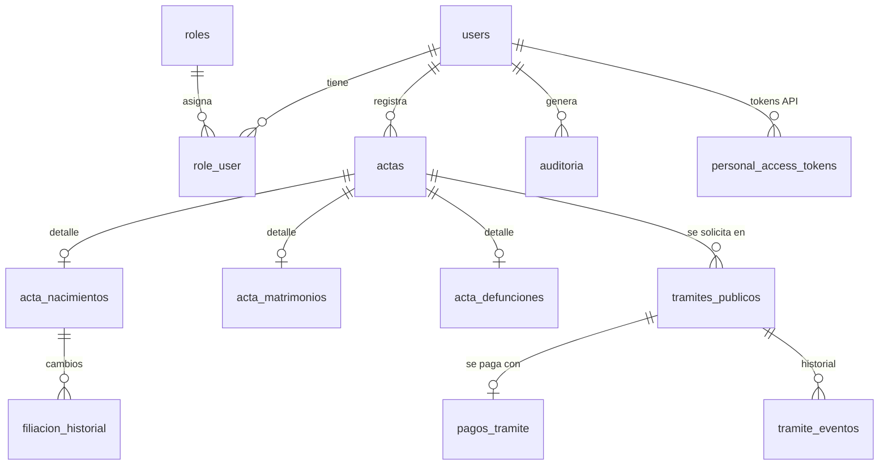

# Análisis de base de datos y caché — Sprint 2

Este documento revisa cómo el sistema guarda y consulta sus datos, mide las consultas que más se repiten
con un archivo de **50 000 actas y 10 000 solicitudes pagadas**, y explica las mejoras aplicadas en este
sprint: consultas por fecha que sí usan su índice y una caché para los resúmenes del panel y de la bandeja.

| Dato | Valor |
|---|---|
| Motor | MySQL 9.7 (desarrollo y carga) · SQLite en memoria para las pruebas automáticas |
| ORM | Eloquent (Laravel 12) con migraciones versionadas (`codigo/database/migrations`, 26 archivos) |
| Caché | `CACHE_STORE=file` (un servidor) · `array` en las pruebas |
| Sesiones y colas | En base de datos (`sessions`, `jobs`, `failed_jobs`) |
| Decisión | ADR-030 en `analisis-de-sistema/07-decisiones-arquitectonicas.md` |

## 1. Modelo de datos



| Grupo | Tablas | Qué guarda |
|---|---|---|
| Archivo municipal | `actas`, `acta_nacimientos`, `acta_matrimonios`, `acta_defunciones`, `acta_secuencias`, `filiacion_historial` | Ficha común del acta y su detalle por tipo (1 a 1), numeración por tipo e historial de cambios de filiación |
| Trámite ciudadano | `tramites_publicos`, `pagos_tramite`, `tramite_eventos` | Solicitud del ciudadano (datos personales **cifrados**), su pago (1 a 1) y el historial de estados |
| Personal y seguridad | `users`, `roles`, `role_user`, `auditoria`, `password_reset_tokens`, `personal_access_tokens` | Cuentas, roles, bitácora y tokens de la API |
| Infraestructura | `sessions`, `jobs`, `failed_jobs`, `job_batches`, `cache`, `cache_locks`, `configuraciones` | Sesiones, cola de correos, caché opcional en BD y parámetros |

### Reglas que protege la propia base de datos
| Regla | Cómo |
|---|---|
| No repetir un acta | `UNIQUE (numero_acta, anio, tipo)` y `UNIQUE (pdf_hash)`: el mismo PDF no se archiva dos veces |
| Numeración sin huecos ni duplicados | `UNIQUE (tipo, orden_tipo)`, `UNIQUE (tipo, sobre, correlativo)` y bloqueo de fila sobre `acta_secuencias` |
| Un solo pago por solicitud y sin cobros dobles | `UNIQUE (tramite_publico_id)`, `UNIQUE (idempotencia)` y únicos sobre cada id del proveedor |
| Decisiones simultáneas | Columna `version` + `lockForUpdate()` (bloqueo optimista y de fila; 28 puntos en el código) |
| Privacidad | `datos` cifrado (`encrypted:array`); el DNI se busca por `dni_hash` (HMAC) sin guardarlo en claro |
| Integridad referencial | Claves foráneas entre detalle y acta, trámite y acta, pago y trámite, eventos y usuarios |

## 2. Consultas críticas medidas

Medición con `EXPLAIN ANALYZE` de MySQL sobre la base de carga `registro_civil_carga` (50 000 actas,
10 000 solicitudes pagadas), la misma usada en la prueba de escalabilidad AC03.

| # | Consulta (dónde) | Plan de ejecución | Tiempo | Veredicto |
|---|---|---|---|---|
| 1 | Búsqueda pública: detalle por fecha del hecho | Rango sobre índice `fecha_nacimiento` | 0,55 ms | ✅ |
| 2 | Búsqueda pública: actas candidatas | Rango sobre `PRIMARY` | 1,3 ms | ✅ |
| 3 | Archivo: primera página ordenada por fecha | Índice `fecha_acta` en reversa, 15 filas | 7 ms | ✅ |
| 4 | Archivo: conteo para paginar | Conteo de InnoDB | 11 ms | ✅ |
| 5 | Archivo y reportes: rango de fechas con `DATE(fecha_acta)` | **Recorre las 50 000 filas** del índice | 56 ms | ❌ corregida |
| 6 | La misma consulta comparando la columna directamente | Rango sobre índice, 655 filas | 0,66 ms | ✅ |
| 7 | Archivo: nombre con `LIKE '%texto%'` en los tres detalles | Recorrido completo de cada tabla | 164 ms | ⚠️ aceptable (ver §5) |
| 8 | Panel: conteo por tipo | Índice `tipo` (cubriente) | 2,4 ms × 3 | caché |
| 9 | Panel: actas por año | Índice `anio` (cubriente) | 5 ms | caché |
| 10 | Bandeja: resumen por estado de las pagadas | Une 10 000 pagos con 10 000 solicitudes y agrupa | **95–185 ms** | ❌ caché |
| 11 | Bandeja: página de 15 | `PRIMARY` en reversa + búsqueda única del pago | 3,4 ms | ✅ |
| 12 | Seguimiento por correo y `dni_hash` | Índice `email` + filtro | 0,09 ms | ✅ |
| 13 | Panel: actividad reciente | Recorre 165 filas (tabla pequeña) | 1,7 ms | ✅ |

**Índices compuestos descartados para la consulta 10.** Se probaron `pagos_tramite (estado, tramite_publico_id)`
y `tramites_publicos (id, estado)`: el tiempo siguió en ~100 ms, porque el costo está en agrupar 10 000
filas en cada visita y no en encontrarlas. No se añadieron; un índice que no se usa solo hace más lentas
las escrituras.

## 3. Mejoras aplicadas en el Sprint 2

| Mejora | Archivos | Antes → después (50 000 actas) |
|---|---|---|
| Filtros de fecha sin `DATE()`: se compara la columna `DATE` directamente y el límite final como «antes del día siguiente» (incluye el último día y funciona igual en MySQL y SQLite) | `ActaService::buscar()`, `ReporteController` | 56 ms → 0,66 ms por consulta |
| Caché del resumen del panel (4 conteos + actas por año) | `DashboardService`, `Acta::booted()` | 16,8 ms → 0,21 ms por visita |
| Caché del resumen de la bandeja | `AtencionPublicaController@index`, `TramitePublico::transicionar()` | 94,5 ms → 0,11 ms por visita |

Los tiempos de caché son la mediana de 5 lecturas sin caché y 20 con caché, medidas dentro de la aplicación.

## 4. Estrategia de caché

Patrón **cache-aside**: la aplicación pide el dato a la caché; si no está, lo consulta en la base de datos y
lo guarda. El punto delicado de toda caché es **cuándo deja de ser válida**; aquí se resuelve borrándola
justo donde cambian los datos, no esperando a que caduque.

| Clave | Contenido | Se invalida cuando | TTL de seguridad |
|---|---|---|---|
| `consultas:panel` | Conteos por tipo y por año | Se guarda o elimina un `Acta` (eventos del modelo) y al terminar `pruebas:generar-datos` | 10 min |
| `consultas:bandeja-resumen` | Solicitudes pagadas por estado | Cualquier cambio de estado: todos pasan por `TramitePublico::transicionar()` | 5 min |
| `config.{clave}` | Parámetros de `configuraciones` | `Configuracion::establecer()` | 1 h |
| `incidencias:fuentes:{hash}` | Lotes de importación ya leídos | La clave incluye el hash del contenido: un lote nuevo o cambiado genera otra clave | 1 día |

Decisiones de diseño:
- **Invalidación después del *commit*** (`DB::afterCommit` en `CacheConsultas::olvidar()`). Si se borrara
  dentro de la transacción, otra petición podría volver a guardar el dato viejo antes de confirmarse el
  cambio. Si la transacción se revierte, la caché no se toca porque nada cambió.
- **El TTL no es el mecanismo principal**: solo cubre cargas masivas que no disparan eventos del modelo.
- **Lo que no se guarda en caché, a propósito**: datos personales de los ciudadanos, la búsqueda pública
  (debe reflejar el archivo en el momento y está limitada por intentos), los PDF, las páginas por usuario
  y la actividad reciente (cambia a cada momento y ya es una lectura indexada barata).
- **Bloqueos**: la caché también sirve para exclusión mutua: `Cache::lock` evita enviar dos veces el mismo
  documento por correo y crear dos órdenes de pago a la vez (almacén `file`, compartido por los procesos
  del servidor).
- **Almacén**: `file` basta para un solo servidor. Si se usaran varios (Sprint 3), la caché y los bloqueos
  deben compartirse: `CACHE_STORE=database` (tablas `cache` y `cache_locks` ya creadas) o Redis, sin
  cambiar código.

## 5. Hallazgos pendientes (no aplicados)

| Hallazgo | Impacto actual | Propuesta |
|---|---|---|
| Búsqueda por nombre con `LIKE '%texto%'` recorre las tres tablas de detalle (164 ms con 50 000 actas) | Aceptable: la página del archivo cumple p95 ≤ 2 s (AC03) | Índice `FULLTEXT` con *parser* `ngram` si el archivo crece mucho más |
| Tablas `solicitudes` y `solicitud_eventos` sin uso en el código | Ninguno (vacías) | Retirarlas con una migración en una versión futura, tras confirmar que no hay datos históricos |
| Filtro de fechas de la auditoría usa `DATE(created_at)` | Ninguno hoy (cientos de filas) | Mismo cambio que en el archivo, respetando la hora de Lima, cuando la bitácora crezca |

## 6. Verificación

| Qué se comprueba | Prueba |
|---|---|
| La segunda visita al panel no vuelve a contar el archivo y un acta nueva actualiza el resumen | `CacheConsultasTest::test_el_panel_se_sirve_de_cache_y_se_actualiza_al_registrar_un_acta` |
| Cada cambio de estado invalida el resumen de la bandeja | `CacheConsultasTest::test_el_resumen_de_la_bandeja_se_invalida_en_cada_cambio_de_estado` |
| La invalidación espera al *commit* y un *rollback* no borra la caché | `CacheConsultasTest::test_la_invalidacion_espera_al_commit_y_un_rollback_no_borra_el_cache` |
| El filtro de fechas incluye ambos extremos | `CacheConsultasTest::test_el_filtro_por_fechas_del_archivo_incluye_ambos_extremos` |
| Unicidad, bloqueo optimista e idempotencia | `MejorasFlujoTest::test_una_decision_con_version_desactualizada_se_rechaza_sin_cambiar_nada`, `YapeOrdersTest::test_tras_un_timeout_reenvia_con_la_misma_clave_de_idempotencia`, `MercadoPagoTest::test_webhook_valida_firma_y_confirma_una_sola_vez` |
| DNI cifrado e índice ciego | `EndurecimientoTest::test_el_dni_se_guarda_como_indice_ciego_y_no_en_claro` |

Suite completa tras los cambios: **146 pruebas, 1 528 aserciones, 0 fallos**; PHPStan nivel 5 sin errores.

## 7. Cómo reproducir las mediciones

```powershell
# 1. Base de carga con 50 000 actas y 10 000 solicitudes pagadas (una sola vez)
# En .env: DB_DATABASE=registro_civil_carga
php artisan migrate
php artisan pruebas:generar-datos --actas=50000 --tramites=10000 --exportar=tests/carga/datos-50k.json

# 2. Plan y tiempo de una consulta
mysql -uroot registro_civil_carga -e "EXPLAIN ANALYZE SELECT COUNT(*) FROM actas WHERE fecha_acta >= '2020-01-01' AND fecha_acta < '2021-01-01'"

# 3. Pruebas de caché
php artisan test --filter=CacheConsultasTest
```
