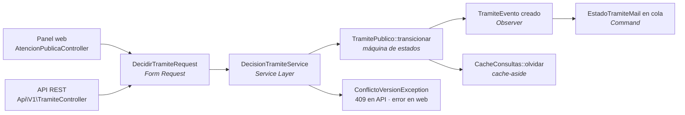

# Principios SOLID y patrones de diseño — Sprint 2

Este documento muestra **dónde** aplica el código cada principio SOLID y cada patrón, con el archivo exacto
para comprobarlo. También señala lo que todavía no cumple, qué se corrigió en este sprint y qué se deja como
deuda técnica.

Todas las rutas son relativas a `codigo/`.

## 1. Vista general: una decisión del personal

El mismo caso de uso, «aprobar, observar o rechazar una solicitud», atraviesa todas las capas y reúne la
mayoría de los patrones:



## 2. Principios SOLID

### S — Responsabilidad única
Cada clase tiene **una razón para cambiar**:

| Responsabilidad | Dónde | Cambia solo si… |
|---|---|---|
| Validar la entrada | `app/Http/Requests/*` (9 Form Requests: `StoreActaRequest`, `DecidirTramiteRequest`, `ReporteRequest`…) | cambian los datos que se aceptan |
| Autorizar | `app/Policies/ActaPolicy.php`, `UserPolicy.php`, `AuditoriaPolicy.php` y middleware `EnsureUserHasRole` | cambian los permisos |
| Regla de negocio | `app/Services/*` (`DecisionTramiteService`, `ActaService`, `CodigoTramiteService`…) | cambia la regla |
| Dar forma a la respuesta JSON | `app/Http/Resources/V1/ActaResource.php`, `TramiteResource.php` | cambia el contrato de la API |
| Hablar con un proveedor externo | `ApisPeruService`, `MercadoPagoService`, `YapeOrdersService`, `FirmaPeruService` | cambia la API del proveedor |
| Comparar nombres de personas | `app/Support/NombrePersona.php` (**Sprint 2**) | cambia el criterio de comparación |

**Corregido en el Sprint 2:**
- La regla para decidir una solicitud estaba dentro del controlador web y se iba a duplicar en la API. Se
  extrajo a `DecisionTramiteService` (ADR-029). Ahora panel y API la comparten.
- La normalización de nombres estaba copiada en `ApisPeruService` y `BusquedaPublicaService`. Ahora vive
  solo en `NombrePersona`, y un cambio de criterio ya no puede dejar las dos copias desalineadas.

### O — Abierto/cerrado
El sistema crece **agregando** código o configuración, sin modificar lo que ya funciona:

| Extensión | Cómo se agrega | Qué no se toca |
|---|---|---|
| Nuevo estado o transición del trámite | Una entrada en `TramitePublico::TRANSICIONES` o `TRANSICIONES_AUTOMATICAS` | `transicionar()` ni los controladores |
| Nuevo aviso al ciudadano | Una entrada en `EstadoTramiteMail::INDICACIONES` | El observador que encola el correo |
| Nuevo reporte | Una entrada en `ReporteRequest::REPORTES` (título, descripción, filtros) | La validación genérica de filtros |
| Nuevo proveedor de identidad (por ejemplo, RENIEC directo) | Una clase que implemente `ContrastadorIdentidad` y una línea en `AppServiceProvider::register()` | `PortalPublicoController` |
| Nueva protección transversal | Un middleware más en `bootstrap/app.php` | Los controladores |

### L — Sustitución de Liskov
Cualquier implementación de un contrato debe poder reemplazar a otra sin romper a quien la usa:
- `ContrastadorIdentidad` documenta los cuatro resultados posibles y que un fallo del proveedor se informa con
  `RuntimeException`. `PrincipiosSolidTest` reemplaza `ApisPeruService` por otra implementación y el portal
  funciona igual: crea la solicitud si los datos coinciden y no crea nada si no coinciden.
- Todas las Form Requests, Policies, Mailables y Resources respetan el contrato de su clase base de Laravel.
  El *framework* las usa sin saber cuál es cuál.

### I — Segregación de interfaces
Los contratos son pequeños y específicos. Nadie depende de métodos que no usa:
- `ContrastadorIdentidad` tiene **un solo método**, `contrastar()`.
- `ShouldQueue` es una interfaz marcadora: `EstadoTramiteMail` la implementa solo para indicar que se envía
  en segundo plano.
- Cada Policy expone solo las acciones de su recurso (`viewAny`, `create`, `update`…).

### D — Inversión de dependencias
Las clases de alto nivel reciben sus dependencias; no las crean:
- **Inyección por constructor** en 7 clases (por ejemplo `DashboardController(DashboardService)` o
  `Api\V1\ActaController(ActaService)`), y **por método** en 25 acciones de controlador.
- **Dependencia de una abstracción (Sprint 2):** `PortalPublicoController::registrar()` recibe
  `ContrastadorIdentidad`, no `ApisPeruService`. El enlace está en un solo lugar:
  ```php
  // app/Providers/AppServiceProvider.php
  $this->app->bind(ContrastadorIdentidad::class, ApisPeruService::class);
  ```
  Según la restricción RC06, APIsPerú no equivale a RENIEC. Cuando exista un conector directo, bastará con
  escribir la clase nueva y cambiar esa línea.

## 3. Patrones de diseño presentes

| Patrón | Dónde | Para qué |
|---|---|---|
| **MVC** | `app/Http/Controllers`, `resources/views`, `app/Models` | Separar la presentación, el control y los datos (estilo del Sprint 1) |
| **Service Layer** | `app/Services/*` | Reglas de negocio reutilizables por la web, la API y los comandos |
| **Máquina de estados por tabla** (variante de *State*) | `TramitePublico::TRANSICIONES` + `transicionar()` | Un único lugar decide qué cambio de estado es válido; sube la versión y registra el evento |
| **Observer** | `TramiteEvento::booted()` (evento `created` → correo en cola); `Acta::booted()` (`saved`/`deleted` → invalida la caché) | Reaccionar a cambios sin que quien los provoca conozca a quien reacciona |
| **Adapter** | `ApisPeruService`, `MercadoPagoService`, `YapeOrdersService`, `FirmaPeruService` | Traducir la API de cada proveedor al lenguaje del sistema, con TLS verificado (`PortalHttpOptions`) |
| **Contrato / Inyección de dependencias** | `app/Contracts/ContrastadorIdentidad.php` + contenedor de Laravel | Cambiar la implementación sin tocar a quien la usa |
| **Chain of Responsibility** | Middleware: `ForzarRespuestaJson` → `auth:sanctum` → `role:` → `throttle` → `CabecerasSeguridad` | Cada eslabón atiende o deja pasar la petición |
| **Command** | Comandos Artisan (`respaldo:crear`, `tramites:mantenimiento`…) y correos en cola | Encapsular una operación para programarla, encolarla o reintentarla |
| **Active Record** | Modelos Eloquent | El modelo conoce su propia persistencia |
| **DTO / Presenter** | API Resources (`ActaResource`, `TramiteResource`) | Exponer solo los campos permitidos: sin PDF, DNI ni código de acceso |
| **Template Method** | `FormRequest` (`rules`, `authorize`, `messages`), `Mailable` (`envelope`, `content`) | El *framework* fija el algoritmo; cada clase completa los pasos |
| **Bloqueo optimista** (*Optimistic Offline Lock*, Fowler) | Columna `version` + `lockForUpdate()` en `DecisionTramiteService` | Dos personas no se pisan la decisión; la segunda recibe un conflicto |
| **Clave de idempotencia** | `pagos_tramite.idempotencia`, reenvío tras *timeout* en `YapeOrdersService` | Un reintento no cobra dos veces |
| **Índice ciego** (*blind index*) | `TramitePublico::hashDni()` → `dni_hash` | Buscar por DNI sin guardarlo en claro |
| **Cache-aside** | `app/Services/CacheConsultas.php` (ADR-030) | Resúmenes rápidos, invalidados donde cambian los datos |

## 4. Deuda técnica identificada (no corregida en este sprint)

| Hallazgo | Principio | Impacto | Propuesta |
|---|---|---|---|
| 17 llamadas a `app(Servicio::class)` dentro de métodos (localizador de servicios), sobre todo en `PortalPublicoController` y `EntregaDocumentoController` | D | Las dependencias quedan ocultas; para probarlas hay que reemplazarlas en el contenedor | Pasarlas a inyección por método o constructor al tocar cada controlador |
| `PortalPublicoController` (220 líneas) y `EntregaDocumentoController` (221) validan en línea y coordinan varios servicios | S | Más difíciles de leer y de cambiar | Mover la validación a Form Requests y la coordinación a servicios, como se hizo con `DecidirTramiteRequest` |
| `AppServiceProvider::boot()` registra límites de intentos, el transporte SMTP con TLS, un *view composer* y las Policies | S | Varias razones para cambiar un mismo archivo | Separarlo en proveedores por tema (`SeguridadServiceProvider`, `CorreoServiceProvider`) |
| Mercado Pago y Yape no comparten una interfaz de pasarela | O | Ninguno hoy: sus flujos son distintos (redirección frente a orden directa) y sus invariantes comunes ya están en `PagoTramite` y `transicionar()` | Crear la interfaz `PasarelaPago` cuando se agregue un tercer proveedor; antes sería una abstracción prematura |
| `Api\ActaApiController` (API interna de sesión) convive con `Api\V1\ActaController` | S / DRY | Poca duplicación; ambas usan `ActaService` | Retirar la API interna cuando el panel deje de usarla |

## 5. Verificación

| Qué se comprueba | Prueba |
|---|---|
| Una sola regla de nombres, sin importar orden, tildes ni signos | `PrincipiosSolidTest::test_una_sola_regla_compara_nombres_sin_importar_orden_tildes_ni_signos` |
| El contrato se resuelve con APIsPerú por defecto | `PrincipiosSolidTest::test_el_contrato_de_identidad_se_resuelve_con_apisperu_por_defecto` |
| El portal funciona con cualquier implementación (L y D) | `PrincipiosSolidTest::test_el_portal_funciona_con_cualquier_implementacion_del_contrato`, `PrincipiosSolidTest::test_si_la_implementacion_no_coincide_no_se_crea_solicitud_ni_cobro` |
| Web y API usan la misma regla de decisión | `ApiV1Test::test_decidir_por_la_api_usa_la_misma_regla_que_el_panel` |
| Las transiciones se validan en un solo lugar | `MejorasFlujoTest::test_las_transiciones_no_permitidas_se_rechazan_en_un_solo_lugar` |
| Bloqueo optimista | `MejorasFlujoTest::test_una_decision_con_version_desactualizada_se_rechaza_sin_cambiar_nada` |
| El adaptador de APIsPerú distingue «sin resultados» de una falla | `CruceParentescoTest::test_sin_resultados_es_distinto_de_fallo_de_servicio_y_nunca_es_contrastado` |
| Análisis estático (tipos, contratos y firmas) | PHPStan / Larastan nivel 5 sin errores |
