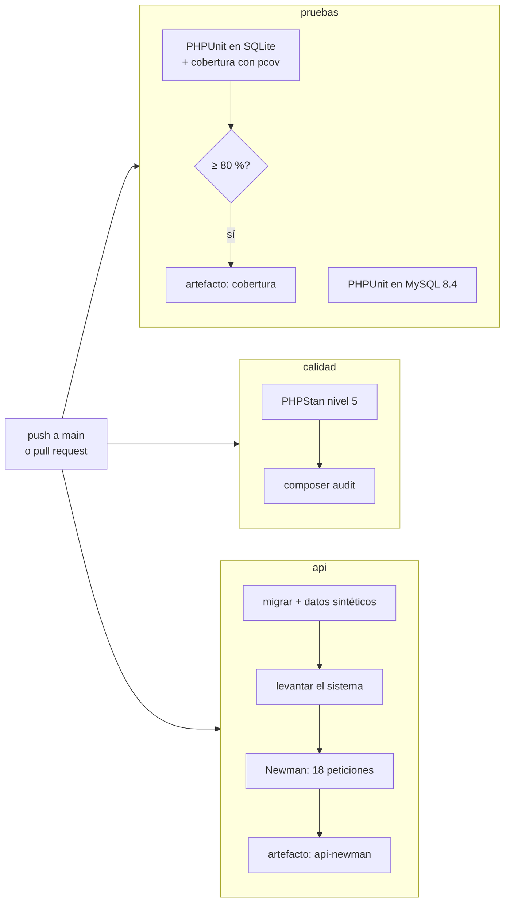

# Pruebas automatizadas, cobertura e integración continua — Sprint 2

| Dato | Valor |
|---|---|
| Herramienta de pruebas | **PHPUnit 11.5** (el equivalente de Jest en PHP/Laravel; la guía de laboratorio usa Jest porque su proyecto es Node.js) |
| Pruebas | **156 pruebas, 1 570 verificaciones, 0 fallos**, en 34 clases (`codigo/tests/Feature`) |
| Cobertura de líneas | **84,15 %** (2 113 de 2 511 líneas de `codigo/app`) · mínimo exigido en CI: **80 %** |
| Pruebas de la API | Colección Postman de 18 peticiones y 38 verificaciones, ejecutada con Newman |
| Análisis estático | PHPStan/Larastan nivel 5, sin errores |
| CI | GitHub Actions, `.github/workflows/ci.yml` en la raíz del repositorio |
| Detalle por archivo | [evidencias/cobertura-por-archivo.md](evidencias/cobertura-por-archivo.md) |

## 1. Estrategia de pruebas

| Nivel | Qué verifica | Herramienta | Dónde |
|---|---|---|---|
| Funcionales (*feature*) | Cada criterio de aceptación de las especificaciones SDD, de la petición HTTP a la base de datos | PHPUnit + `RefreshDatabase` | `codigo/tests/Feature/*Test.php` |
| De unidad sobre reglas puras | Servicios y reglas sin HTTP: verificación de firmas, normalización de nombres, máquina de estados, caché | PHPUnit | `CoberturaCriticaTest`, `PrincipiosSolidTest`, `CacheConsultasTest`, `MejorasFlujoTest` |
| De contrato | Que `docs/api/openapi.yaml` y las rutas reales coincidan | PHPUnit + `symfony/yaml` | `ContratoOpenApiTest` |
| De API de punta a punta | El sistema levantado responde como dice el contrato | Postman / Newman | `codigo/tests/api/registro-civil-api.postman_collection.json` |
| Análisis estático | Tipos, firmas y llamadas inexistentes | PHPStan nivel 5 | `codigo/phpstan.neon` |
| Atributos de calidad | Rendimiento, escalabilidad, concurrencia | k6 | `codigo/tests/carga` · [06-atributos-de-calidad.md](06-atributos-de-calidad.md) |

Reglas que siguen todas las pruebas:
- Cada prueba parte de una base vacía (SQLite en memoria) y crea solo sus datos.
- Los servicios externos nunca se llaman de verdad: `Http::preventStrayRequests()` hace fallar la prueba si
  algo intenta salir a Internet, y APIsPerú, Mercado Pago y Yape se simulan con `Http::fake()`.
- Correo, colas y archivos se reemplazan por dobles (`Mail::fake()`, `Storage::fake()`).
- Los nombres de las pruebas describen el comportamiento esperado en español, por ejemplo
  `test_una_decision_con_version_desactualizada_se_rechaza_sin_cambiar_nada`. Las tablas de verificación de
  las especificaciones (`02-especificaciones/`) enlazan cada criterio con su prueba.

## 2. Cobertura

### 2.1 Resultado por capa

| Capa | Cobertura | Lectura |
|---|---|---|
| Middleware | 98,0 % | Toda la seguridad transversal (roles, acceso del portal, JSON, cabeceras, límites) está probada |
| Form Requests | 96,9 % | Las reglas de validación de entrada |
| Controladores | 90,9 % | Los flujos web y de la API |
| Modelos | 87,6 % | Incluye la máquina de estados `transicionar()` |
| Servicios | 86,7 % | Reglas de negocio e integraciones |
| Policies | 85,7 % | Autorización por rol |
| Recursos de la API | 78,9 % | El 21 % restante es el `ActaResource` antiguo, que no usa nadie (ver §2.3) |
| Providers | 57,4 % | El transporte SMTP con TLS solo se activa con un archivo de certificados |
| Comandos de consola | 44,1 % | `pruebas:generar-datos` es una herramienta de carga y el volcado con `mysqldump` necesita MySQL |
| Notificaciones | 0 % | Las pruebas de recuperación de clave simulan el envío (`Notification::fake()`) |

### 2.2 Brechas corregidas en esta fase
El reporte mostró que `FirmaDocumentoService`, el código que decide si un PDF firmado es íntegro, tenía
**20,8 %**. El caso positivo siempre se simulaba con un *mock*, así que nunca se había comprobado que una
firma real se aceptara. Se agregó `CoberturaCriticaTest`:

| Prueba | Qué demuestra |
|---|---|
| `test_una_firma_cms_valida_se_verifica_y_queda_pendiente_de_revision_humana` | Firma un documento de verdad (CMS separado sobre el `/ByteRange`, con un certificado de prueba generado en el momento) y el servicio la acepta, extrae el firmante y la huella SHA-256, y **no** marca confianza automática |
| `test_un_byte_cambiado_despues_de_firmar_invalida_la_firma` | Un solo byte modificado después de firmar hace fallar la verificación |
| `test_una_firma_de_otro_contenido_no_se_acepta` | Una firma válida, pero de otro contenido, se rechaza |
| `test_el_adaptador_dni_distingue_coincidencia_nombre_y_verificador` | APIsPerú: coincidencia con tildes y otro orden, nombre distinto, dígito verificador distinto y DNI ajeno |
| `test_sin_token_configurado_no_se_consulta_al_proveedor` | Sin credenciales no sale ninguna petición |
| `test_un_usuario_desactivado_con_sesion_abierta_es_expulsado` | Desactivar a alguien lo saca aunque ya tuviera la sesión abierta |

Resultado: `FirmaDocumentoService` pasó de 20,8 % a 64,6 % (lo restante es `preparar()`, que ejecuta Python
para estampar el sello), el middleware de usuario activo pasó al 100 % y el total, de 82,99 % a 84,15 %.

### 2.3 Brechas conocidas y aceptadas

| Archivo | Cobertura | Motivo | Acción |
|---|---|---|---|
| `Console/Commands/GenerarDatosPrueba.php` | 0 % | Herramienta para preparar las pruebas de carga; se ejecuta en el job `api` del CI | Ninguna |
| `Console/Commands/RecuperarCopiasFirmadas.php` | 0 % | Comando de mantenimiento manual | Prueba propia en un sprint futuro |
| `Http/Resources/ActaResource.php` (sin `V1`) | 0 % | **Código muerto**: ninguna clase lo usa desde que existe `V1\ActaResource` | Eliminarlo |
| `Models/Configuracion.php` | 0 % | **Código muerto**: la tabla existe, pero ningún código lee parámetros de ella | Eliminarlo o usarlo |
| `Services/PdfStorageService.php` | 56,3 % | Las ramas sin cubrir son errores del disco (permisos, disco lleno) | Pruebas con un disco simulado que falle |
| `Console/Commands/CrearRespaldo.php` | 64,1 % | El volcado real con `mysqldump` requiere MySQL; la copia incremental sí está probada | Probarlo en el job de MySQL |

**Por qué el mínimo es 80 % y no 100 %:** el umbral evita que la cobertura retroceda sin que nadie lo note.
Perseguir el 100 % llevaría a escribir pruebas para herramientas internas y ramas de error del sistema
operativo, que aportan poco frente a su costo. La cobertura actual deja 4 puntos de margen.

## 3. Integración continua

El flujo de trabajo estaba en `codigo/.github/workflows/tests.yml`. GitHub solo ejecuta los que están en la
**raíz** del repositorio, así que se movió a `.github/workflows/ci.yml`, con `working-directory: codigo` en
todos los pasos.



| Job | Qué hace | Falla si… |
|---|---|---|
| `pruebas` (SQLite) | Ejecuta las 156 pruebas con cobertura y publica el reporte HTML y Clover como artefacto `cobertura` | Falla una prueba o la cobertura de líneas baja del 80 % (`tests/cobertura-minima.php`) |
| `pruebas` (MySQL) | Las mismas pruebas sobre MySQL 8.4, el motor real | Falla una prueba (bloqueos, tipos de fecha o restricciones distintas a SQLite) |
| `calidad` | PHPStan nivel 5 y `composer audit` | Aparece un error de tipos o una librería con una vulnerabilidad conocida |
| `api` | Crea una base nueva con 300 actas y 21 solicitudes sintéticas, levanta el sistema y ejecuta la colección Postman con Newman | Falla alguna de las 38 verificaciones; el reporte HTML queda como artefacto `api-newman` |

Los tres jobs corren en paralelo. Las dependencias de Composer se guardan en caché según `composer.lock`, y
`concurrency` cancela una ejecución anterior de la misma rama si llega un *push* nuevo.

> **Estado:** el flujo se validó localmente paso por paso: suite con cobertura, umbral, `composer audit` y
> la colección Newman sobre una base SQLite recién creada (38/38). En GitHub correrá con el primer *push*
> al repositorio del curso.

## 4. Cómo ejecutarlo y mostrarlo

Desde la carpeta `codigo`:

```powershell
# Suite completa (unos 25 s)
php artisan test

# Una sola área, por ejemplo la verificación de firmas
php artisan test --filter=CoberturaCriticaTest

# Cobertura con reporte HTML (usa el Xdebug de Laravel Herd, sin modificar php.ini) y lo abre en el navegador
powershell -ExecutionPolicy Bypass -File tests\cobertura.ps1 -Abrir

# Análisis estático
vendor\bin\phpstan analyse --memory-limit=1G
```

En GitHub, después del *push*: pestaña **Actions** → flujo **CI** → la ejecución más reciente. Abajo, en
**Artifacts**, se descargan `cobertura` (abrir `html/index.html`) y `api-newman` (reporte de Postman).
