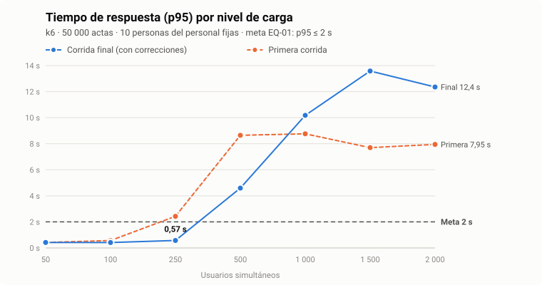
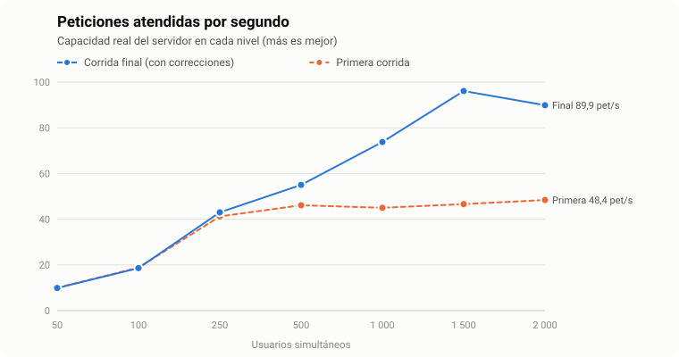
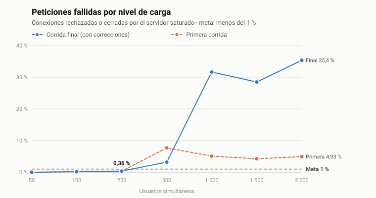

# Resultados del Sprint 2 — de un vistazo

Todo lo que se midió en el Sprint 2, en una sola página. Cada número viene de un archivo de
[`evidencias/`](../evidencias/), y el análisis completo está en
[`06-atributos-de-calidad.md`](../06-atributos-de-calidad.md).

## Veredicto por atributo de calidad

| | Escenario | Meta | Resultado medido | Evidencia |
|:-:|---|---|---|---|
| ✅ | **EQ-01** Rendimiento | p95 ≤ 2 s, errores < 1 % | **0,57 s** de p95 con **250 usuarios** a la vez y 50 000 actas | [k6 final](../evidencias/eq-progresiva-final.txt) |
| ⚠️ | **EQ-03** Escalabilidad | Hasta 2 000 usuarios | Llega a 2 000 sin caerse ni corromper datos, pero desde 500 un solo portátil se satura | [resumen JSON](../evidencias/eq-progresiva-final-resumen.json) |
| ✅ | **EQ-02** Disponibilidad | Ningún fallo externo confirma un pago ni entrega | **17 / 17** fallos simulados bajo control | `DisponibilidadProveedoresTest` |
| ✅ | **EQ-04** Seguridad | 100 % de accesos indebidos rechazados | Postman **71 / 71**; OWASP ZAP **0 alertas altas**; 0 librerías vulnerables | [ZAP portal](../evidencias/eq04-zap-portal.html) · [ZAP panel](../evidencias/eq04-zap-panel.html) |
| ✅ | **EQ-05** Mantenibilidad | Pruebas en verde, PHPStan sin errores | **174 pruebas, 1 715 verificaciones, 0 fallos**; cobertura **84 %** | [cobertura](../evidencias/cobertura-por-archivo.md) |
| ✅ | **EQ-06** Integridad | Con decisiones simultáneas, solo una se aplica | 50 personas a la vez: **5 aplicadas, 45 rechazadas, 0 inesperadas** | [k6](../evidencias/eq06-concurrencia.txt) · [BD](../evidencias/eq06-concurrencia-bd.txt) |
| ✅ | **EQ-07** Auditoría | Todo cambio deja historial | 5 / 5 decisiones con su auditoría | [BD](../evidencias/eq06-concurrencia-bd.txt) |
| ✅ | **EQ-08** Recuperabilidad | RTO < 30 min, 100 % de hashes correctos | **21 / 21** tablas, **29 / 29** documentos, **60 / 60** descifrados; RTO **11 s** con 50 000 actas | [simulacro](../evidencias/eq08-restauracion.json) · [RTO](../evidencias/eq08-rto-50k.txt) |

**7 de 8 cumplen.** EQ-03 cumple hasta 250 usuarios; pasar de ahí con un p95 ≤ 2 s requiere varios
servidores, y eso es trabajo del Sprint 3 (recomendaciones en la
[§8 del informe](../06-atributos-de-calidad.md#8-recomendaciones-para-el-sprint-3-no-implementadas-aquí)).

## Carga progresiva: 50 → 2 000 usuarios simultáneos

Herramienta **k6**, 50 000 actas, 10 personas del personal fijas y ciudadanos que crecen en cada nivel.
Se comparan la **primera corrida** y la **corrida final**, ya con los cuellos de botella corregidos.







**Cómo leerlos:**
- Hasta 250 usuarios, la corrida final está muy por debajo de la meta de 2 s.
- Las correcciones casi **duplicaron la capacidad**: de ~48 a ~90–96 peticiones por segundo.
- Por encima de 500 usuarios el servidor atiende más peticiones, pero la cola de espera crece. Por eso la
  latencia y los rechazos de conexión suben en las dos corridas: el límite es un solo portátil, no la aplicación.
  En los registros no hubo ningún error de la aplicación.

| Usuarios | Pet./s | p95 total | Fallidas | Meta |
|---:|---:|---:|---:|:-:|
| 50 | 9,9 | 423 ms | 0,00 % | ✅ |
| 100 | 18,6 | 415 ms | 0,18 % | ✅ |
| 250 | 43,0 | 573 ms | 0,36 % | ✅ |
| 500 | 55,0 | 4 592 ms | 3,21 % | ❌ |
| 1 000 | 73,8 | 10 179 ms | 31,64 % | ❌ |
| 1 500 | 96,1 | 13 577 ms | 28,49 % | ❌ |
| 2 000 | 89,9 | 12 354 ms | 35,36 % | ❌ |

## Problemas que encontraron las pruebas, y cómo se corrigieron

| Hallazgo | Corrección | Efecto |
|---|---|---|
| bcrypt se calculaba **con la fila bloqueada** al enviar el código de seguimiento | El hash se calcula antes de abrir la transacción (`CodigoTramiteService`) | Esperas por bloqueo en MySQL: de 405 s a **0** |
| nginx en Windows servía solo ~160 archivos estáticos por segundo | `open_file_cache`, `sendfile` y `multi_accept` | **×9** (1 435 archivos/s) |
| Windows mandaba PHP a los núcleos de eficiencia | Prioridad `AboveNormal` al levantar el servidor | **×2,3** (160 → 376 pet./s) |
| ZAP: los errores 404 salían **sin cabeceras de seguridad** y mostraban la versión de PHP | `CabecerasSeguridad` pasó a ser un middleware global | Corregido y cubierto con una prueba |
| ZAP: faltaba `form-action` en la política CSP | Se añadió `form-action` con los únicos destinos externos (Mercado Pago y WhatsApp) | Corregido y cubierto con una prueba |
| Concurrencia: carreras al compilar vistas en el primer arranque | Calentamiento antes de medir (`setup()` de k6) y cola `database` | 0 respuestas inesperadas |

## Seguridad (EQ-04)

| Prueba | Resultado |
|---|---|
| Matriz de autorización (Postman/Newman) | 53 peticiones, **71 verificaciones, 0 fallidas** |
| `composer audit` | **0** vulnerabilidades conocidas |
| OWASP ZAP, portal sin sesión | Antes: [informe](../evidencias/eq04-zap-portal-antes.html) → después: [informe](../evidencias/eq04-zap-portal.html), **0 altas** |
| OWASP ZAP, panel con sesión del personal | [informe](../evidencias/eq04-zap-panel.html): 2 alertas altas, ambas **falsos positivos** comprobados |

Análisis completo, alerta por alerta: [`codigo/docs/calidad/AC04-seguridad.md`](../../codigo/docs/calidad/AC04-seguridad.md).

## Pruebas automáticas e integración continua

- **174 pruebas** de PHPUnit con **1 715 verificaciones**, en SQLite y en MySQL.
- Cobertura de líneas: **84,15 %**. El CI exige un mínimo de 80 %.
- PHPStan nivel 5 sin errores.
- Colección Postman de la API ejecutada con Newman ([informe](../evidencias/api-postman-newman.html)).
- Todo corre en **GitHub Actions** en cada push ([`.github/workflows/ci.yml`](../../.github/workflows/ci.yml)).

## Todas las evidencias

| Archivo | Qué contiene |
|---|---|
| [`eq-progresiva-final.txt`](../evidencias/eq-progresiva-final.txt) | Salida de k6 de la corrida final (50 → 2 000 usuarios) |
| [`eq-progresiva-final-resumen.json`](../evidencias/eq-progresiva-final-resumen.json) | p95, peticiones por segundo y fallos por nivel y operación |
| [`eq-progresiva-final-recursos.json`](../evidencias/eq-progresiva-final-recursos.json) | CPU y RAM por proceso cada 2 s |
| [`eq-progresiva-20php-*`](../evidencias/) | Primera corrida, antes de las correcciones |
| [`eq-progresiva-48php-*`](../evidencias/) | Experimento descartado con 48 procesos PHP |
| [`eq06-concurrencia.txt`](../evidencias/eq06-concurrencia.txt) | k6: 50 decisiones simultáneas |
| [`eq06-concurrencia-bd.txt`](../evidencias/eq06-concurrencia-bd.txt) | Comprobación en MySQL: una decisión, una versión y una auditoría por solicitud |
| [`eq08-restauracion.json`](../evidencias/eq08-restauracion.json) | Simulacro de restauración: tablas, hashes y descifrado |
| [`eq08-rto-50k.txt`](../evidencias/eq08-rto-50k.txt) | Tiempo de restauración con 50 000 actas |
| [`eq04-zap-*.html`](../evidencias/) | Informes de OWASP ZAP (ábrelos descargados para verlos con formato) |
| [`api-postman-newman.html`](../evidencias/api-postman-newman.html) | Informe de Newman de la API |
| [`cobertura-por-archivo.md`](../evidencias/cobertura-por-archivo.md) | Cobertura por archivo |

## Volver a generar los gráficos

Los gráficos se generan desde los JSON de las evidencias; ningún número se escribió a mano:

```bash
cd codigo
php tests/carga/graficos-progresiva.php
```
